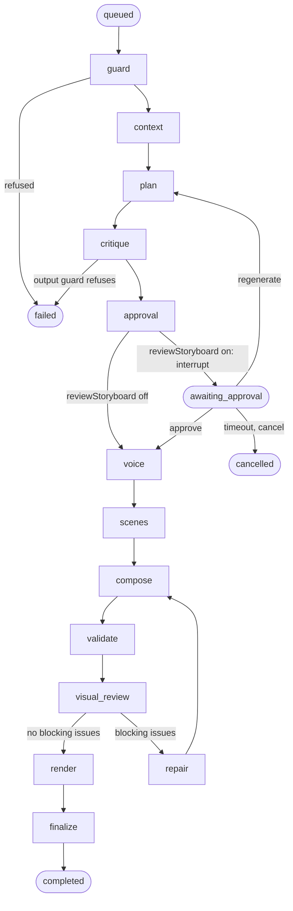

# AI generation pipeline

This is the reference for Phase 9: the model layer, prompts and guardrails, system skills, the `storyboard@1` and `scene-module@1` contracts, the LangGraph pipeline, repair and degradation, cancellation, charging, the jobs API and the settings that tune all of it. The render and audio engine it feeds is in [`render.md`](render.md) and [`audio.md`](audio.md); the content policy is [`ai-policy.md`](ai-policy.md); evaluation is [`evals.md`](evals.md).

Decisions behind it: [ADR 0009](adr/0009-narration-first-generation-pipeline.md) (order of work), [0029](adr/0029-scene-builders-assembled-by-code.md) (scene modules), [0030](adr/0030-graceful-degradation-with-fallback-scenes.md) (fallback scenes), [0031](adr/0031-predictable-charging.md) (charging), [0032](adr/0032-revisions-as-child-jobs.md) (revisions), [0033](adr/0033-eval-gated-prompt-activation.md) (eval-gated prompts), [0034](adr/0034-generation-queue-for-long-running-graphs.md) (queue), [0035](adr/0035-composition-checks-run-on-the-render-queue.md) (composition checks on the render queue).

## 1. Where the code lives

| Path                                 | Owns                                                                                                                                                                   |
| ------------------------------------ | ---------------------------------------------------------------------------------------------------------------------------------------------------------------------- |
| `engine/ai/storyboard.py`            | `storyboard@1` models and the deterministic validator                                                                                                                  |
| `engine/ai/job_options.py`           | `JobOptions`, `JobStatus`                                                                                                                                              |
| `engine/ai/scenes/`                  | `scene-module@1` models, static checks, the composer and the fallback scene                                                                                            |
| `engine/ai/llm/`                     | The LiteLLM client, routing, structured output, budgets, tracing and the fake client                                                                                   |
| `engine/ai/prompts/`                 | System prompt sources (`system/<key>.md`), the sandboxed renderer, canaries and the output scanner                                                                     |
| `engine/ai/guardrails/`              | The input guard, the output guard and the policy codes                                                                                                                 |
| `engine/ai/skills/`                  | The system skill library (`library/<layer>/<slug>/SKILL.md`), the loader and the router                                                                                |
| `engine/ai/graphs/generate_video.py` | The LangGraph graph; `engine/ai/nodes/` holds one file per node                                                                                                        |
| `engine/ai/ports.py`                 | The interfaces the graph needs from the outside world                                                                                                                  |
| `modules/generation`                 | `jobs`, `storyboards`, `scenes`, `job_events`, `share_links`; the jobs, library, share and admin routes; the adapters that implement the ports; the tasks and sweepers |
| `modules/prompts`                    | `prompt_templates`, `prompt_versions`, `eval_runs`; the admin prompt and eval routes; the seed command                                                                 |
| `modules/skills`                     | `skills`, `skill_versions`, `skill_files`, `skill_embeddings` (system skills in this phase); the seed command; the admin routes                                        |
| `evals/`                             | Datasets, suites, thresholds and the runner                                                                                                                            |

`engine` imports nothing from `modules`. The graph talks to the database, the credits wallet, the media module and the skill tables only through the protocols in `engine/ai/ports.py`; `modules/generation` implements them and wires the graph in its task. Nodes hold no database session while a model call is in flight: every port method opens its own short transaction.

## 2. The graph



LangGraph runs with the Postgres checkpointer in schema `langgraph`; the thread ID is the job ID. Every node is idempotent: it reads its inputs from the database through the store, skips work already recorded and writes its outputs before the next node starts, so a run that is retried after a worker crash resumes at the first incomplete node and never repeats a paid call that already finished. A node fails the job only on a permanent error; a transient error raises and procrastinate retries the task.

State carried through the checkpoint is small: the job ID, the node markers, the selected skill slugs and counters. Storyboards, narration, scene modules and reports live in tables.

### 2.1 Nodes

| #   | Node            | Status while running | Reads                                          | Writes                                                                                    | Permanent failure                                                                 |
| --- | --------------- | -------------------- | ---------------------------------------------- | ----------------------------------------------------------------------------------------- | --------------------------------------------------------------------------------- |
| 1   | `guard`         | `planning`           | the query or topic                             | event `guard.passed`                                                                      | refusal: `policy_*` code (see `ai-policy.md`)                                     |
| 2   | `context`       | `planning`           | preferences, topic, options, skills, providers | selected skill slugs in state, event `context.ready`                                      | `no_style_skill` when the chosen style is missing                                 |
| 3   | `plan`          | `planning`           | context, selected skills, parent storyboard    | storyboard version (origin `planner`)                                                     | `model_output_invalid`, `budget_exceeded`, `llm_unavailable`                      |
| 4   | `critique`      | `planning`           | the latest storyboard                          | storyboard version (origin `critic`) when revised, event `critique.completed`             | `policy_output_blocked` from the output guard                                     |
| 5   | `approval`      | `awaiting_approval`  | the latest storyboard                          | `approved_at` on the approved version, events `approval.requested` and `approval.granted` | none: timeout cancels instead                                                     |
| 6   | `voice`         | `voicing`            | the approved storyboard                        | narration document, scene durations and word timings, `scene.voiced` events               | `tts_failed`                                                                      |
| 7   | `scenes`        | `generating`         | narration, style and visual skills             | one scene module per scene, `scene.generated` events                                      | `model_output_invalid` after the re-ask for a scene falls back instead of failing |
| 8   | `compose`       | `generating`         | the scene modules, the style tokens            | the composition document (a deterministic function of the modules)                        | none                                                                              |
| 9   | `validate`      | `validating`         | the composition, narration                     | validation issues, event `validation.completed`                                           | none: issues feed repair                                                          |
| 10  | `visual_review` | `validating`         | sampled key frames                             | review issues, event `review.completed`                                                   | none: a failed review call is recorded and skipped                                |
| 11  | `repair`        | `generating`         | issues per scene, the previous module          | a repaired module or the fallback, events `scene.repaired` and `scene.fallback`           | `composition_invalid` when a fallback scene still has blocking issues             |
| 12  | `render`        | `rendering`          | the composition, narration, options            | `jobs.render_id`, `render.progress` events                                                | the render's own failure code                                                     |
| 13  | `finalize`      | `rendering`          | the render and its renditions                  | charge, completion event, notification, `JobCompleted`                                    | none                                                                              |

Node 7 generates scene modules in parallel with the concurrency from `ai.scene_concurrency`. Nodes 8 to 11 form the loop: `compose → validate → visual_review → repair → compose`. `repair` increments a per-scene attempt counter; a scene that reaches `ai.max_repairs` attempts with blocking issues is replaced by its fallback instead of being sent to the model again. The loop ends when no scene has blocking issues, which the fallback guarantees.

### 2.2 Job status and stages

`jobs.status` follows `docs/db/state-machines.md`. `jobs.current_stage` is the node name. A transition is a conditional update that fails when the job is already terminal or cancel was requested, which is how a node learns to stop.

### 2.3 Events

Every node writes `job_events` rows (append-only) and publishes the same message to the Redis channel `<REDIS_KEY_PREFIX>:job:<jobId>` after commit. Types are lowercase dotted names.

| Type                                       | Payload                                                     |
| ------------------------------------------ | ----------------------------------------------------------- |
| `job.created`                              | `creditsReserved`                                           |
| `stage.started`, `stage.completed`         | `stage`, `durationMs` on completion                         |
| `guard.passed`, `context.ready`            | `skills` (slugs) on `context.ready`                         |
| `storyboard.ready`                         | `version`, `sceneCount`                                     |
| `critique.completed`                       | `revised`, `blockingIssues`                                 |
| `approval.requested`, `approval.granted`   | `version`, `expiresAt`                                      |
| `scene.voiced`                             | `sceneId`, `durationMs`                                     |
| `scene.generated`                          | `sceneId`                                                   |
| `scene.repaired`                           | `sceneId`, `attempt`, `issueCodes`                          |
| `scene.fallback`                           | `sceneId`, `reason`                                         |
| `validation.completed`, `review.completed` | `errors`, `warnings` or `issues`                            |
| `render.progress`                          | `renderId`, `stage`, `progress` (persisted every 10 points) |
| `job.completed`                            | `creditsCharged`, `durationMs`, `fallbackSceneIds`          |
| `job.failed`, `job.cancelled`              | `code`, `message`, `creditsReleased`                        |

Payloads never carry prompts, skill content, model output text beyond ids and codes, secrets or contact data.

`GET /v1/jobs/{id}/events` sends `event: snapshot` with the job first, then each stored event the client has not seen (`Last-Event-ID`, UUIDv7 order is time order), then live messages from Redis. The SSE frames are `event: snapshot` (the job) and `event: job_event` (`{ id, type, stage, payload, at }`); the SSE `id` is the `job_events.id`; Redis-only progress frames carry no id. A heartbeat comment goes out every 15 seconds, the stream re-reads the job every 10 seconds so a lost message cannot hang it, ends after a terminal event, and each user may hold at most five streams (same lease mechanism as render events).

## 3. Contracts

### 3.1 `storyboard@1`

`engine/ai/storyboard.py`. The wire form is camelCase.

| Field                    | Rule                                                                                                                          |
| ------------------------ | ----------------------------------------------------------------------------------------------------------------------------- |
| `title`, `summary`       | 1 to 120 and 1 to 600 characters                                                                                              |
| `audienceLevel`          | `beginner`, `intermediate`, `advanced`                                                                                        |
| `language`               | BCP 47 as `en` or `en-IN`                                                                                                     |
| `targetDurationMs`       | 10,000 to 120,000, the requested duration                                                                                     |
| `aspects`                | one to three unique values of `16:9`, `9:16`, `1:1`                                                                           |
| `styleSkill`             | slug of the style skill                                                                                                       |
| `scenes`                 | 2 to 12 scenes with unique IDs and positions `0..n-1`                                                                         |
| scene `id`               | `^[a-z][a-z0-9-]{0,31}$`, stable across edits                                                                                 |
| scene `goal`             | 1 to 300 characters                                                                                                           |
| scene `narration`        | 1 to 2000 characters                                                                                                          |
| scene `visualBrief`      | 1 to 4000 characters                                                                                                          |
| scene `layoutNotes`      | an entry for every requested aspect, 1 to 600 characters each                                                                 |
| scene `visualSkills`     | up to three slugs                                                                                                             |
| scene `keyTerms`         | up to eight terms                                                                                                             |
| scene `onScreenText`     | up to six lines of at most 120 characters; the total per scene is bounded per aspect (160 for 16:9, 90 for 9:16, 120 for 1:1) |
| scene `targetDurationMs` | 1,000 to 120,000                                                                                                              |

`validate_storyboard` returns issues (never raises) for the rules that depend on the request: scene count, the sum of scene durations within ±10 % of the request, the speaking rate of each scene within `ai.speaking_rate_min_milli_wps` to `ai.speaking_rate_max_milli_wps`, on-screen text per aspect, aspects, language and style matching the job, and layout notes for every aspect. The storyboard editor shows the same issues inline.

### 3.2 `scene-module@1`

`engine/ai/scenes/models.py`.

| Field     | Rule                                                                                                                                         |
| --------- | -------------------------------------------------------------------------------------------------------------------------------------------- |
| `sceneId` | equals the storyboard scene ID                                                                                                               |
| `builder` | the body of `build(ctx)` written against `runtime@1`; at most 20,000 characters; synchronous                                                 |
| `css`     | at most 20,000 characters; every selector starts with the scene root class `.mo-s-<sceneId>`                                                 |
| `assets`  | up to eight inline SVG assets with IDs; the composer places each in the scene element as `<div data-asset="<id>">` so the builder queries it |

The whole module is at most 120,000 characters.

**Static checks** (`engine/ai/scenes/static_checks.py`, before composition): the builder parses as JavaScript; it references only `ctx`, `gsap`, `Math`, `Array`, `Object`, `Number`, `String`, `JSON`, `Set`, `Map`, `document` (read and element creation only) and names it declares itself; it contains no `await`, `async`, `import`, `eval`, `Function`, `window`, `globalThis`, timers, `Date`, `performance`, network, storage or navigation identifiers; the CSS parses, every selector is prefixed by the root class, and it contains no `@import`, `url()` to anything but `data:` images, `position: fixed` outside the root or `!important` on the root; assets are well-formed SVG without scripts, `foreignObject` or external references; sizes hold. The checks also forbid `this`, `.constructor`, `__proto__`, `ownerDocument`, `defaultView`, `.random` (including `gsap.utils.random`), `gsap.ticker`, `gsap.delayedCall`, HTML comment markers and literal creation of `script`, `iframe` or similar elements, and allow `parseInt`, `parseFloat`, `isNaN`, `isFinite`, `RegExp` and `Error`. A builder cannot read its scene's absolute start (`window.__narration` is forbidden), so CSS animations aligned to the scene start would need a new runtime version. The static checks are fast feedback for repair, not the security control: the Phase 8 sanitizer, sandbox and validator run on every composed document.

**Composer** (`engine/ai/scenes/composer.py`): `compose(modules, storyboard, style) → str`. The same inputs always give byte-identical HTML. The document contains the runtime includes from `docs/render.md` section 2, the style skill's tokens as an `html[data-aspect]` override of the `--mo-*` variables (a plain `:root` rule loses to `base.css` in 16:9), one `<style data-mo-scene-style="<id>">` block per scene (`data-scene` would collide with the scene element lookup), one `<section class="mo-scene mo-s-<id>" data-scene="<id>">` per scene in storyboard order holding its assets, and a single `Motionile.composition({ aspects, scenes })` call with each builder body inside `build(ctx) { ... }`. Only `gsap.min.js` and `motionile.js` are included: no GSAP plugin. Script and style text is escaped so a builder cannot close its element early. Golden tests compare the output to files byte for byte.

**Fallback scene** (`engine/ai/scenes/fallback.py`): kinetic typography of the scene narration in the job's style. It shows a window of at most twelve words that advances with `ctx.at(index)`, so any narration length fits the safe area in every aspect.

## 4. The model layer

`engine/ai/llm/`. One client wraps LiteLLM. Every call declares a task from `guard`, `route`, `plan`, `critique`, `scene`, `repair`, `vision_review`, `caption`.

- **Routing.** The platform setting `ai.model_routing` holds, per task, the primary model, ordered fallbacks, temperature, maximum output tokens and timeout. The client reads it per job, so it changes without a deploy.
- **Structured output.** `generate(call, OutputModel)` returns a validated Pydantic instance. On a schema violation it re-asks once with the validation errors and then raises `model_output_invalid`.
- **Reliability.** Transient errors (timeouts, rate limits, 5xx) retry with exponential backoff and jitter up to a bound, then fall to the next model of the route; when none is left the call raises `llm_unavailable`.
- **Budget.** `ai.job_token_budget` caps the tokens of a job across all tasks. The client sums the job's recorded usage before each call and raises `budget_exceeded` when the call would pass the cap.
- **Caching.** The system blocks (system prompt plus selected skills) are marked cacheable for providers that support prompt caching, so repeated scene calls pay for the stable prefix once.
- **Accounting.** Every call writes a `usage_records` row through `UsageLedger`: stage, provider, model, input and output tokens, and the cost from LiteLLM's cost map in micro-dollars. The idempotency key is derived from the call key, so a retried node records usage once.
- **Tracing.** One Langfuse trace per job, one span per node and per call. Narration and queries are included; contact details and tokens are redacted before leaving the process. Tracing is a no-op when the Langfuse keys are unset.
- **Fakes.** With `PROVIDERS_MODE=fake` the client is a scripted fake: deterministic responses per task from fixtures under `tests/fixtures/llm/`. The planner returns fixture storyboards that fit the requested duration; the scene task adapts the Phase 8 golden compositions into scene modules. The whole pipeline runs without network access.

## 5. Prompts and leak protection

- **Sources.** System prompts live in `engine/ai/prompts/system/<key>.md` with frontmatter (`key`, `version`, `variables`). Keys: `guard.input`, `guard.output`, `router.skills`, `planner.storyboard`, `critic.storyboard`, `scene.module`, `repair.scene`, `review.vision`. `python -m motionile.scripts.seed_prompts` runs after migrations on deploy and is idempotent: a changed checksum creates a new draft version; it never activates one. The only exception is the flag `--bootstrap-fake-providers`, used by the local and CI stack: fake-provider environments have no model to evaluate, so it activates the latest version of every template without a run. It refuses to run, before touching the database, unless `APP_ENV` is `local` or `ci` and `PROVIDERS_MODE` is `fake`, and each bootstrap activation is audited. Rollback derives the previous version from the audit entries of earlier activations (`prompts.version_activated`, `prompts.version_rolled_back`), so no extra column is needed. Admin evaluation runs are tasks `prompts.run_eval` on the `generation` queue that call the `EvalExecutor` installed with `install_eval_executor`; without one the run ends `errored` with `eval_executor_unavailable`. Admin routes are rate limited by `prompts.write`.
- **Rendering.** Jinja2 sandboxed environment with strict undefined variables. Only variables declared in the frontmatter are passed.
- **Canaries.** Every version has a canary string embedded in the rendered system prompt. The output scanner rejects any model output that contains a canary of any active prompt, or a verbatim overlap with any active system prompt or loaded skill (a shared run of twelve or more words), logs the attempt and raises `output_blocked`. Scene code is checked for canaries only, because a scene legitimately reuses patterns from the skills it was given.
- **User data is data.** Queries, storyboard edits and revision instructions enter prompts only inside delimited blocks (`<user_query>`, `<storyboard_edit>`, `<revision_instructions>`, `<narration>`, `<previous_attempt>`, `<issues>`) whose closing tag is neutralized in the text, and every system prompt states that block content is data and never instructions.
- **Never exposed.** No API returns a prompt body, a canary, a system skill body or the model's raw output. Errors and logs carry codes and ids only. The single exception is the admin prompt diff (`GET /v1/admin/prompts/templates/{key}/diff`): it returns a line diff of two versions to `prompts.manage` holders only, with canary lines redacted, `Cache-Control: no-store` and an audit entry per call. System skill bodies have no exception.
- **Activation.** Admins list versions and diffs, create drafts, start eval runs and activate a version only when each required suite has a finished, passing `eval_runs` row that covers it ([ADR 0033](adr/0033-eval-gated-prompt-activation.md)). Rollback activates the previous version.

## 6. Guards

`engine/ai/guardrails/` ([`ai-policy.md`](ai-policy.md)).

- **Input guard.** Deterministic rules first (length, control characters, known injection and extraction phrases), then the cheap `guard` model. It runs on every query, every storyboard edit and every regeneration or revision instruction, and returns `allow` or `refuse` with a policy code.
- **Output guard.** The storyboard and narration are checked against the same policy before any TTS or rendering spend.

## 7. Skills and the router

System skills are written as `SKILL.md` files under `engine/ai/skills/library/<layer>/<slug>/` and seeded by `python -m motionile.scripts.seed_skills` (system skills have no owner; a changed checksum creates a new version; each description is embedded with `EMBEDDING_MODEL` into `skill_embeddings`). The seed runs after the prompt sync on deploy and is idempotent: it compares the checksum of each file with the current version, adds a version when it changed (earlier versions stay), and embeds again every description whose stored `model` differs from the configured one. It reads the title of the first level-1 heading as the display name, refuses a library that breaks the loader rules (names equal folders, the shipped list of 5 style, 10 visual and 15 domain skills, per-layer size caps of 3,600, 12,000 and 7,200 characters, style tokens equal to the token sets in `engine/ai/scenes/style_tokens.py`) and writes one transaction per skill under an advisory lock. The admin routes `GET /v1/admin/skills`, `GET /v1/admin/skills/{slug}` and `POST /v1/admin/skills/reseed` (permission `skills.manage`) return metadata, the checksum prefix, the token cost and the embedding status (`ready`, `stale`, `missing`), never the text of a skill.

**Layers.** Style: `minimal-dark` (the brand default), `whiteboard`, `blueprint`, `terminal`, `editorial-light`. Visual: `kinetic-typography`, `flow-diagram`, `architecture-build-up`, `code-walkthrough`, `data-structure-operations`, `comparison-split`, `timeline-sequence`, `math-equation`, `data-chart-story`, `concept-metaphor`. Domain: `system-design`, `backend`, `frontend`, `devops`, `applied-ai`, `machine-learning`, `blockchain-web3`, `cybersecurity`, `concepts`, `mathematics`, `physics`, `chemistry`, `biology`, `cs-fundamentals`, `economics`.

**Skill file format.** Frontmatter `name`, `description` and `metadata` (`layer`, and for style skills `tokens`, a CSS declaration list that overrides the `--mo-*` variables). The body has: when to use it, the teaching or visual structure, do and don't lists, `runtime@1` code patterns and worked example scene modules. An example is a level-4 heading `#### Example: <title>`, a line `Narration: "<text>"` and fenced `js` (the builder), `css` and optional `svg` blocks; tests extract every example, run the static checks and compose and validate it in the sandbox.

**Router.** Candidates per layer by embedding similarity to the query, the topic and its catalog `skill_hints`. A cheap model selects with reasons within these constraints: exactly one style (the user's preference or the explicit option wins), up to three visual skills, up to two domain skills, and a token budget for skill content (`ai.skill_token_budget`). Only the selected skills' full content enters prompts. Phase 10 adds user skills and pinning.

## 8. Repair and degradation

1. `validate` runs the Phase 8 sanitizer, sandbox and validator across every requested aspect. Errors are issues attributed to a scene by the report's `scene` field; document-level issues are attributed to every scene they name or, failing that, to the scene whose builder the sandbox error points at.
2. `visual_review` renders sampled key frames per scene and aspect through the sandbox and sends them to the vision model with a rubric: legibility, layout, relevance to the narration, style consistency, visual errors. The result is a list of issues per scene with a severity; `blocking` issues join the validation errors.
3. `repair` regenerates each failing scene's module with its issues and the previous attempt as delimited data. At most `ai.max_repairs` attempts per scene; the next failure replaces the scene with the fallback. `compose` runs again and the loop repeats until no scene has blocking issues.

The attempts of a scene, their issue codes and the fallback are kept on the scene row (`attempts`, `is_fallback`) and shown to admins; the user sees a notice for each fallback scene on the finished video.

## 9. Cancellation, failure and sweepers

- **Cancellation** is allowed until `finalize`. `POST /v1/jobs/{id}/cancel` sets `cancel_requested_at` and cancels a queued or waiting job at once; running nodes check the flag between steps, the `render` node cancels the active render, and the job ends `cancelled` with its reservation released.
- **Failure.** A permanent error sets `failed` with a stable user-facing `error_code` and a short message, publishes `job.failed` and releases the reservation.
- **Sweepers** (queue `generation`): `generation.fail_stalled_jobs` (every 5 minutes) fails jobs whose `updated_at` is older than `ai.stage_timeout_minutes` outside `awaiting_approval` and releases their credits; `generation.cancel_expired_approvals` (every 15 minutes) cancels jobs waiting longer than `ai.approval_timeout_hours`.
- **Resumption.** A graph slice is a task `generation.run_job` deferred with `lock=<jobId>`; after a worker restart the same thread resumes from its last checkpoint. Approval defers a new slice that resumes the interrupt.

## 10. Charging

```
subtotal = charging.base_credits + charging.credits_per_second × seconds
total    = ceil(subtotal × (100 + charging.extra_aspect_percent × (aspects − 1)) / 100)
           + charging.cloned_voice_premium   (only for a cloned voice)
```

`seconds` is the requested duration for the estimate and the reservation, and the final video duration rounded up for the charge. The charge is `min(formula(final), reservation)`; the rest is released. `estimate_credits` is one pure function used by `POST /v1/jobs/estimate`, `POST /v1/jobs` and `finalize`, and the parameters are public settings so the formula is published. Failed and cancelled jobs release everything. True costs are in `usage_records`; analytics compare them with the credits charged.

## 11. Settings

Runtime (platform `system_settings`, admin-editable, cached): `ai.model_routing`, `ai.job_token_budget` (600000), `ai.max_repairs` (2), `ai.scene_concurrency` (4), `ai.approval_timeout_hours` (168), `ai.stage_timeout_minutes` (30), `ai.speaking_rate_min_milli_wps` (2000), `ai.speaking_rate_max_milli_wps` (2800), `ai.skill_token_budget` (12000), `ai.visual_review_enabled` (true), `charging.base_credits` (20), `charging.credits_per_second` (2), `charging.extra_aspect_percent` (40), `charging.cloned_voice_premium` (10), `jobs.max_active_per_user` (2), `evals.ci_live_budget_micros_usd` (2000000).

Environment (`Settings.ai`): `AI_ANTHROPIC_API_KEY`, `OPENAI_API_KEY` (embeddings), `AI_LANGFUSE_PUBLIC_KEY`, `AI_LANGFUSE_SECRET_KEY`, `AI_LANGFUSE_HOST`, `AI_LANGFUSE_PROJECT_ID`, `EMBEDDING_MODEL` (`text-embedding-3-small`), `EMBEDDING_DIMENSIONS` (1536, read by the migration). Deployed service processes refuse to start without the first four.

New permissions: `prompts.manage`, `skills.manage`, `jobs.read_all`, `evals.run`. New rate-limit policies: `jobs.create` (existing, 5/min per user), `share.view` (per IP), `share.manage` (per user), `prompts.write`, `evals.run`.

## 12. Tests

Unit: storyboard and scene-module validation, composer determinism (golden HTML), router constraints, prompt rendering with strict undefined variables, the output scanner, guard decisions on fixtures, the charging formula, every job state transition and the degradation path. Integration (fake LLM and TTS, real Postgres, Redis, Chromium, ffmpeg): the full pipeline with and without approval, resumption after a worker restart, approval edits and timeout, repair and fallback, cancellation at each stage, revisions reusing cached narration, concurrent creation that cannot overspend, and event replay after a disconnect. Root e2e, security and load suites cover the user journeys, IDOR, share-slug enumeration, prompt extraction and limits.
