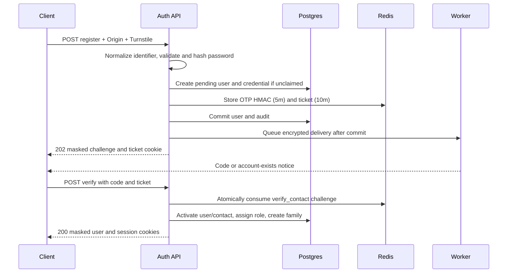

# Authentication

Motionile serves the Phase 4 API under /v1/auth. The generated contract records response models, cookie security, rate policies, Turnstile actions, CSRF requirements and error codes. Users owns users and user_contacts; access owns roles and user_roles; auth owns credentials, oauth_identities and sessions; notifications owns delivery. Permissions arrive in Phase 6.

## Request protection and cookies

Clients send an allowlisted Origin on unsafe requests. Authenticated unsafe requests copy mo_csrf into X-CSRF-Token. Refresh validates CSRF against the refresh token's family and works with an expired access token. OAuth linking also requires this header when starting the flow. Callback linking checks the initiating user and family.

All cookies are Secure, including local development. Browser tests need HTTPS; API tests explicitly retain cookies on a local HTTP stack.

| Cookie            | Domain                   | Path     | HttpOnly | SameSite | Lifetime                                |
| ----------------- | ------------------------ | -------- | -------- | -------- | --------------------------------------- |
| __Secure-mo_at    | Configured shared domain | /        | Yes      | Lax      | 900 seconds                             |
| __Secure-mo_rt    | API host                 | /v1/auth | Yes      | Strict   | Remaining idle lifetime, at most 7 days |
| __Secure-mo_vt    | API host                 | /v1/auth | Yes      | Strict   | 600 seconds                             |
| mo_csrf           | Configured shared domain | /        | No       | Lax      | Browser session                         |
| mo_auth           | Configured shared domain | /        | No       | Lax      | 900 seconds                             |
| __Secure-mo_oauth | API host                 | /v1/auth | Yes      | Lax      | 600 seconds                             |

mo_auth contains access expiry as a UI hint and grants no authority. The separate OAuth cookie survives a provider redirect; see ADR 0016. Logout clears cookies using their original scopes. Verification tickets and OTPs never appear in URLs.

## Registration and contact verification



Existing verified contacts receive the same response shape and an account-exists notice. Ghost challenges preserve request responses without permitting authentication. A valid ticket can resend after its original code expires. OTPs are six digits, HMAC-bound to purpose and destination, expire in five minutes and permit five attempts. Ticket metadata lasts ten minutes; resending invalidates the old challenge and ticket.

## Password login, OTP login and resend

```mermaid
sequenceDiagram
    participant C as Client
    participant A as Auth API
    participant R as Redis
    participant D as Postgres
    C->>A: POST login with identifier/password and Turnstile
    A->>A: Argon2id verify, including dummy hash when unknown
    A->>R: Check identifier lockout
    alt Valid active account
        A->>D: Rehash if needed; create family and audit
        A-->>C: 200 user and cookies
    else Valid unverified contact
        A->>R: Issue verification challenge
        A-->>C: 403 verification_required with ticket and challenge
    else Invalid or locked
        A->>R: Count failures; ten/hour locks passwords for 15m
        A-->>C: 401 invalid_credentials
    end
    C->>A: POST otp/request with identifier and Turnstile
    A->>R: Issue login-purpose challenge and ticket
    A-->>C: Always 202 masked challenge
    Note over A,D: Send code only to an active verified contact
    C->>A: POST otp/resend with ticket after cooldown
    A->>R: Replace challenge and ticket
    A-->>C: 202 new ticket
    C->>A: POST otp/verify with code and ticket
    A->>R: Consume challenge once
    A->>D: Create family and audit
    A-->>C: 200 user and cookies
```

OTP login works during password lockout. Send limits apply across purposes: one/minute and five/hour per destination, fifteen/hour per IP. Suspended users cannot sign in; soft-deleted users are excluded from contact lookup. New passwords contain 10–128 characters. Live mode sends only the first five SHA-1 hex characters to the padded HIBP range API; unavailable service logs a safe warning and fails open. Fake mode performs no outbound breach lookup.

## Rotation, session reads and revocation

```mermaid
sequenceDiagram
    participant C as Client
    participant A as Auth API
    participant D as Postgres
    participant R as Redis
    C->>A: POST refresh with refresh cookie and CSRF
    A->>D: Lock user then refresh row FOR UPDATE
    A->>A: Validate family CSRF, status and expiry
    alt Valid unrotated row
        A->>D: Mark rotated; insert successor in same family
        A-->>C: 204 new cookies
    else Rotated at most 10 seconds ago
        A-->>C: 401 refresh_conflict; no revocation
    else Rotated more than 10 seconds ago
        A->>D: Revoke family and audit reuse
        A->>R: Deny family for 905 seconds
        A-->>C: 401 refresh_reused; queue security notice
    else Idle or absolute expiry
        A-->>C: 401 session_expired
    end
    C->>A: GET me or sessions with access cookie
    A->>D: Owner-scoped user/family lookup
    A-->>C: Masked user or cursor-paginated active families
    C->>A: POST logout, logout-all or DELETE sessions/id with CSRF
    A->>D: Owner-scoped family revocation with reason
    A->>R: Deny affected families
    A-->>C: 204; clear cookies if current family revoked
```

The root session ID is its family ID. Successors retain the original 60-day absolute expiry and receive idle expiry min(now + 7 days, absolute). Exactly one concurrent refresh succeeds. A client receiving refresh_conflict should coordinate with the successful request instead of replaying the old token. Every JWT verification checks the Redis denylist. Tokens live 900 seconds with five seconds of leeway, hence the 905-second denylist TTL. Revocation writes Redis before committing; a transaction failure may conservatively deny a family but cannot commit an unprotected revocation.

Session lists show one active leaf per family, root creation time, last use, device label, IP and current flag. Another user's family returns not_found. Public GET jwks.json returns active public Ed25519 keys with a five-minute cache header. The ring supports current and previous kid values; private seeds are never published.

## Password reset, change and first password

```mermaid
sequenceDiagram
    participant C as Client
    participant A as Auth API
    participant R as Redis
    participant D as Postgres
    C->>A: POST password/forgot with identifier and Turnstile
    A->>R: Issue password_reset challenge and ticket
    A-->>C: Always 202 masked challenge
    C->>A: POST password/reset with code, newPassword and ticket
    A->>R: Consume purpose-bound code
    A->>D: Set hash and revoke all families
    A->>R: Deny all families
    A-->>C: 204; clear cookies; queue notice
    C->>A: POST password/change with old/new password and CSRF
    A->>D: Verify old hash, set new hash, revoke other families
    A->>R: Deny other families
    A-->>C: 204; preserve current family; queue notice
    C->>A: POST password/set/request with CSRF
    A->>R: Issue set_password code for primary verified contact
    A-->>C: 202 ticket, only if password absent
    C->>A: POST password/set with code, newPassword, ticket and CSRF
    A->>R: Consume user-bound challenge
    A->>D: Set first hash, preserve current family
    A-->>C: 204; clear ticket; queue notice
```

OTP reset replaces emailed reset links; see ADR 0015. Password reset revokes every family. Change and first-password set preserve only the current family.

## OAuth login, sign-up, link and unlink

```mermaid
sequenceDiagram
    participant C as Browser
    participant A as Auth API
    participant R as Redis
    participant P as Provider
    participant D as Postgres
    C->>A: GET oauth/provider/start with next and intent
    A->>R: Store state, PKCE, nonce, browser binding, next and intent (10m)
    A-->>C: 302 provider URL and browser cookie
    C->>P: Authorize minimal scopes with S256 challenge
    P-->>C: Redirect to configured callback with code and state
    C->>A: GET callback with browser cookie
    A->>R: Consume state once and check browser/provider binding
    A->>P: Exchange code with verifier; validate identity
    alt Link intent
        A->>D: Require original user/family; attach unclaimed identity
    else Existing identity
        A->>D: Sign in identity owner
    else Verified email matches verified contact
        A->>D: Attach identity and sign in contact owner
    else New verified email
        A->>D: Create active user/contact without password; sign in
    end
    A-->>C: Configured web origin plus next, or login?error=oauth_failed
    C->>A: DELETE oauth/provider with session and CSRF
    A->>D: Require another password, provider or verified-contact OTP method
    A-->>C: 204
```

Google requires email_verified; GitHub requires the primary verified email. Microsoft requires the personal tenant or xms_edov=true. Unverified organizational email cannot create or auto-link an account. OIDC checks signature, issuer, audience, authorized party, nonce and expiry. Microsoft subjects include the tenant ID to prevent cross-tenant subject collisions. Microsoft JWKS key issuers are bound to token tenants, following [Microsoft's guidance](https://learn.microsoft.com/entra/identity-platform/access-tokens). Keys cache for one hour and refresh on unknown kid. Callback failure exposes only oauth_failed. Redirect targets always use configured origins and validated relative paths.

## Error codes

Errors use application/problem+json and urn:motionile:problem:<code>. Request IDs vary; masked destinations reflect caller input. No code, password or bearer token appears in errors.

| Status | Codes                                                                                                                     |
| ------ | ------------------------------------------------------------------------------------------------------------------------- |
| 400    | turnstile_required                                                                                                        |
| 401    | unauthenticated, token_expired, invalid_credentials, invalid_challenge, refresh_conflict, refresh_reused, session_expired |
| 403    | origin_forbidden, origin_not_allowed, csrf_failed, turnstile_failed, verification_required, account_suspended             |
| 404    | not_found                                                                                                                 |
| 409    | verification_conflict, password_already_set, verified_contact_required, last_sign_in_method                               |
| 422    | validation_failed, invalid_identifier, password_policy, password_breached, invalid_redirect                               |
| 429    | rate_limited, otp_cooldown; use Retry-After                                                                               |
| 503    | service_unavailable, turnstile_unavailable                                                                                |

## Notifications and verification

Notification payloads are AES-GCM encrypted before queue insertion. Delivery runs after commit on the default queue, retries failures and prioritizes OTP jobs. The existing after-commit dispatcher has a crash window between commit and queue insertion; ADR 0014 documents this limitation and resend recovery.

The local/CI fake inbox is /v1/_test/inbox/{destination}; deployed apps and exported contracts omit it. Unit tests use fakes and a frozen clock; integration tests use testcontainers; root Playwright tests exercise the API and worker. Root tests wait out real cooldowns. The auth load scenario exercises login and repeated refresh. See the [auth runbook](runbooks/auth.md) for SSM, provider setup, Mailpit, key rotation and staging delivery acceptance.
