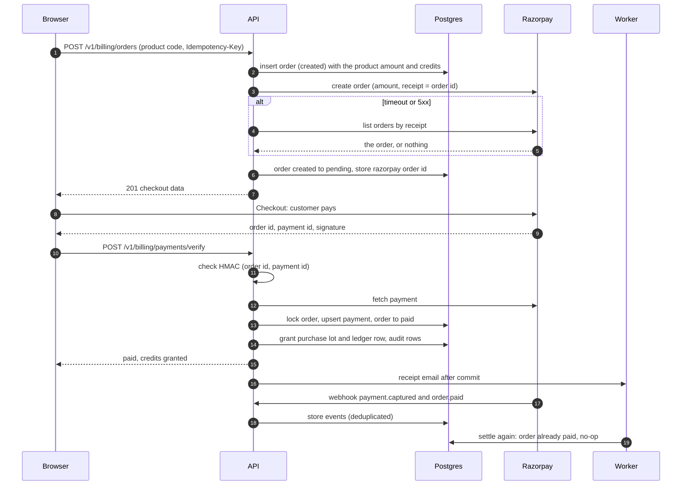
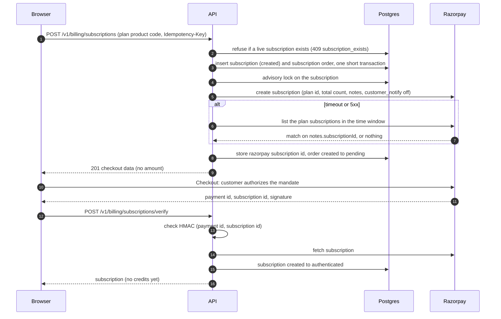
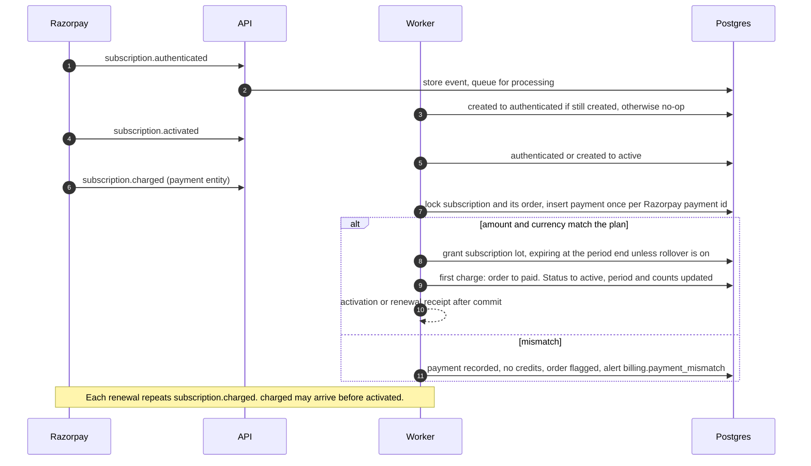
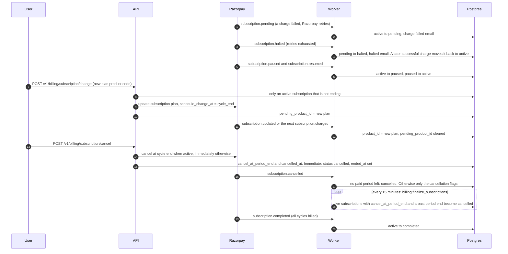
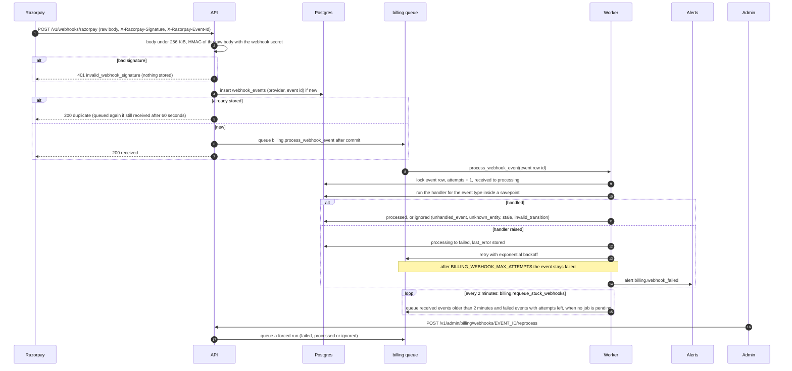
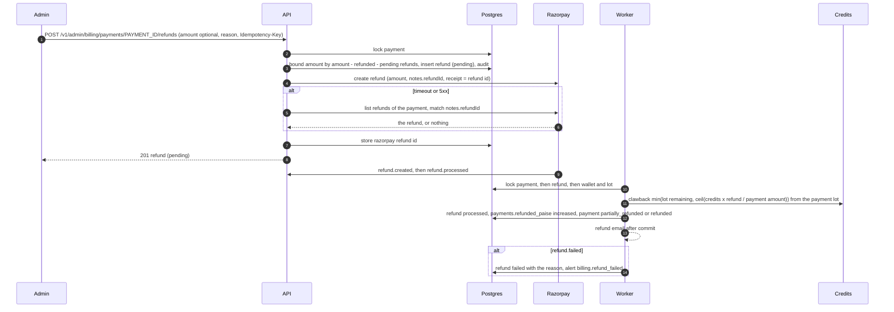
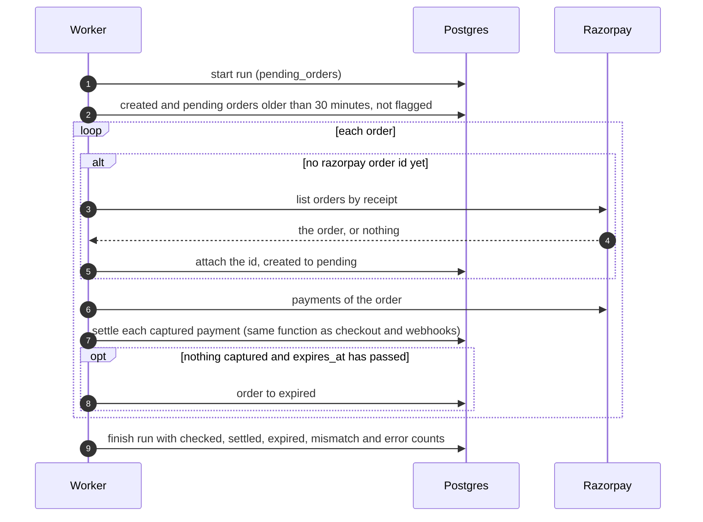
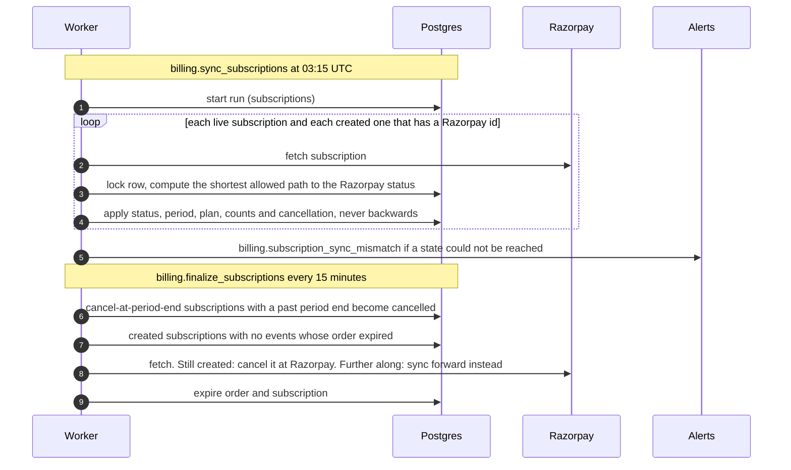
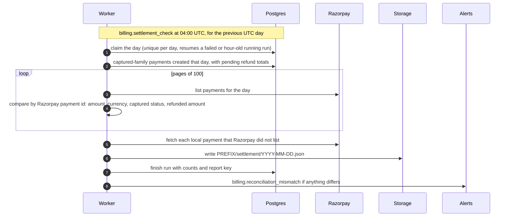

# Billing and credits

How Motionile sells credits, keeps balances correct and recovers from every failure Razorpay can throw at it. This is the long-form companion to [`context.md`](context.md) section 8; when the two disagree, `context.md` wins and this page is fixed in the same pull request. Table designs live in [`db/schema.md`](db/schema.md), status machines in [`db/state-machines.md`](db/state-machines.md), and the decisions behind them in [ADR 0004](adr/0004-razorpay-billing-with-credit-ledger.md), [ADR 0018](adr/0018-credit-lots-and-reservations.md), [ADR 0019](adr/0019-product-immutability-and-versioning.md) and [ADR 0020](adr/0020-gst-inclusive-pricing-and-invoices-follow-up.md).

Operational procedures are in the runbooks: [razorpay-setup.md](runbooks/razorpay-setup.md) for accounts, keys, webhooks and go-live, and [billing-operations.md](runbooks/billing-operations.md) for refunds, disputes, reconciliation and corrections.

## Contents

1. [Overview](#1-overview)
2. [The credit model](#2-the-credit-model)
3. [Products](#3-products)
4. [Flows](#4-flows)
5. [Lock ordering](#5-lock-ordering)
6. [Failure handling](#6-failure-handling)
7. [Alerts](#7-alerts)
8. [Periodic tasks](#8-periodic-tasks)
9. [Settings and runtime flags](#9-settings-and-runtime-flags)
10. [Permissions](#10-permissions)
11. [API endpoints](#11-api-endpoints)
12. [Notifications](#12-notifications)
13. [Test support and the fake Razorpay](#13-test-support-and-the-fake-razorpay)
14. [GST invoices: a documented follow-up](#14-gst-invoices-a-documented-follow-up)

## 1. Overview

Customers buy credits in two ways: one-time credit packs and monthly or yearly subscriptions. Credits are spent by generation jobs, publishing and MCP submissions. Everything is priced in INR, in paise, inclusive of GST.

Two modules share the work:

| Module    | Owns                                                                                                                               | Reaches the other through                                       |
| --------- | ---------------------------------------------------------------------------------------------------------------------------------- | --------------------------------------------------------------- |
| `credits` | `credit_wallets`, `credit_lots`, `credit_reservations`, `credit_ledger`, `usage_records`                                           | Nothing. It never imports `billing`.                            |
| `billing` | `products`, `billing_customers`, `orders`, `payments`, `subscriptions`, `refunds`, `webhook_events`, `billing_reconciliation_runs` | `motionile.modules.credits` only: `grant`, `clawback`, `adjust` |

Rules that hold everywhere:

- Prices, credits and plan IDs come only from `products`. The client sends a product code and nothing else that affects money.
- Money is `bigint` paise and credits are `bigint`. There are no floats anywhere in the money path.
- Every credit change is exactly one append-only `credit_ledger` row with a unique `idempotency_key`, written in the same transaction as the wallet and lot updates.
- Checkout verification, webhooks and reconciliation all settle through one function, `SettlementService.settle` (called `settle_payment` in the other docs). Subscription charges settle through `ChargeRecorder.record`, which follows the same rules. No other code grants credits for money.
- Webhooks are verified on the raw body, stored, deduplicated by event ID and processed asynchronously on the `billing` queue.
- Status changes go through explicit state machines. Every transition is a single `UPDATE ... WHERE status = :expected`.
- A create call to Razorpay that times out is never blindly repeated. The object is looked up first (see [Timeouts on create calls](#timeouts-on-create-calls)).
- Credits are corrected through `adjust` with a reason, never by editing rows.

## 2. The credit model

### Wallet, lots, reservations and the ledger

| Concept     | Table                 | What it is                                                                                                                                                     |
| ----------- | --------------------- | -------------------------------------------------------------------------------------------------------------------------------------------------------------- |
| Wallet      | `credit_wallets`      | One row per user: `balance` (every credit owned), `reserved` (the part held by active reservations) and `version`. Available credits are `balance - reserved`. |
| Lot         | `credit_lots`         | A batch of credits with one source (`purchase`, `subscription`, `admin`, `promo`), an `amount`, a `remaining` amount and an optional `expires_at`.             |
| Reservation | `credit_reservations` | A hold for a job, a publication or an MCP submission. Moves `reserved` on the wallet without touching lots.                                                    |
| Ledger      | `credit_ledger`       | One immutable row per change with `delta`, `reserved_delta`, `balance_after`, `reserved_after`, `reason`, a reference and a unique `idempotency_key`.          |

Operations on `CreditsService`, all taking the caller's session and never committing:

| Operation  | Effect                                                                                                                                                                                                                          |
| ---------- | ------------------------------------------------------------------------------------------------------------------------------------------------------------------------------------------------------------------------------- |
| `grant`    | Creates a lot and a ledger row (`purchase`, `subscription_grant` or `promo_grant`). One lot per payment or admin action (`uq_credit_lots_source_ref`).                                                                          |
| `reserve`  | Fails with `402 insufficient_credits` when `balance - reserved` is short. Fails with `409 reservation_already_active` when the job already holds a reservation. Holds credits for `BILLING_RESERVATION_TTL_SECONDS` by default. |
| `commit`   | Consumes the actual amount from lots in expiry order and releases the rest of the reservation in the same ledger row. The actual amount may not exceed the reservation (`commit_exceeds_reservation`).                          |
| `release`  | Returns the whole reservation. The sweeper uses the same path for reservations past their TTL (status `expired`).                                                                                                               |
| `clawback` | Takes unused credits back from one lot after a refund, capped by what remains in the lot and by `balance - reserved`. Writes nothing when it finds nothing to take.                                                             |
| `adjust`   | Admin grant (a new `admin` lot, optionally expiring) or deduction (consumed from lots in expiry order). A deduction never goes below the reserved amount or below zero (`409 adjustment_exceeds_available`).                    |

Lots are consumed in the order `expires_at NULLS LAST, created_at, id`: the lot expiring soonest first, non-expiring lots last. Purchased credits never expire. Subscription credits expire at the end of their billing period unless the runtime setting `billing.subscription_rollover` is on when the charge is recorded.

### Ledger entries

| Reason               | `delta` | `reserved_delta` | Written by                             | Idempotency key                                         |
| -------------------- | ------- | ---------------- | -------------------------------------- | ------------------------------------------------------- |
| `purchase`           | `> 0`   | `0`              | Credit pack settlement                 | `payment:<payments.id>`                                 |
| `subscription_grant` | `> 0`   | `0`              | Subscription charge                    | `payment:<payments.id>`                                 |
| `promo_grant`        | `> 0`   | `0`              | Promotions (later phase)               | Caller-supplied                                         |
| `admin_adjust`       | `<> 0`  | `0`              | Admin adjustment                       | SHA-256 of `<admin id>:<user id>:<Idempotency-Key>`     |
| `reserve`            | `0`     | `> 0`            | Jobs, publishing, MCP                  | Caller-supplied                                         |
| `commit`             | `<= 0`  | `< 0`            | Jobs, publishing, MCP                  | Caller-supplied                                         |
| `release`            | `0`     | `< 0`            | Jobs, publishing, MCP; the TTL sweeper | Caller-supplied; `reservation:<id>:ttl` for the sweeper |
| `refund_clawback`    | `< 0`   | `0`              | Refund processing                      | `refund:<refunds.id>`                                   |
| `expiry`             | `< 0`   | `0`              | Lazy expiry and the expiry sweep       | `expiry:<lot id>:<wallet version>`                      |

The keys use our own row IDs (`payments.id`, `refunds.id`), never Razorpay IDs, so a key is stable no matter which path (checkout, webhook, reconciliation) reaches the operation first. Repeating an operation with the same key returns the original result; reusing a key for a different operation fails with `409 idempotency_key_conflict`.

### The invariant

For every user at every committed point in time:

1. `credit_wallets.balance` equals the sum of `credit_ledger.delta` and the sum of `credit_lots.remaining`.
2. `credit_wallets.reserved` equals the sum of `credit_ledger.reserved_delta` and the sum of active `credit_reservations.amount`.
3. The newest ledger row's `balance_after` and `reserved_after` equal the wallet's `balance` and `reserved`.
4. `0 <= reserved <= balance`, and no lot has a negative `remaining`.

`credits.check_integrity` verifies all of it for every wallet at 02:30 UTC. Each problem is reported with a named invariant (`balance_equals_ledger_delta_sum`, `balance_equals_lot_remaining_sum`, `reserved_equals_ledger_reserved_sum`, `reserved_equals_active_reservations`, `balance_equals_latest_balance_after`, `reserved_equals_latest_reserved_after`, `balance_non_negative`, `reserved_within_balance`, `lots_non_negative`), the expected value and the actual value, in a `credit_integrity_violation` alert. The check is read-only; it never repairs anything.

### Lazy expiry

Expiry does not wait for the sweeper. `reserve`, `commit`, `clawback` and `adjust` first expire the user's due lots inside the same locked transaction, so expired credits can never be spent between sweeps. `GET /v1/credits/wallet` subtracts credits in already-expired lots from `available` for the same reason. The sweeper `credits.expire_lots` (every 15 minutes) expires lots for users who have not transacted.

### Held credits

Credits held by an active reservation are never expired or clawed back: expiry, clawback and deductions are limited to `balance - reserved`, and whatever could not be taken waits for the next sweep or the reservation settlement. This is why a refund of a pack whose credits are partly held, or already spent, claws back less than it refunds. The refund record shows the credits actually recovered, and that is intended ([ADR 0018](adr/0018-credit-lots-and-reservations.md)).

A reservation that is never settled is released by `credits.release_stale_reservations` (every 5 minutes) once its TTL has passed.

## 3. Products

Products are rows in `products`: `credit_pack` (a price and a credit amount) or `subscription` (a price, an interval of `month` or `year`, credits per period, a `plan_key` shared by the monthly and yearly product of one plan, and a `razorpay_plan_id`).

- `GET /v1/billing/products` is public, cached in Redis for 60 seconds, and answered with `Cache-Control: public, max-age=60, s-maxage=300, stale-while-revalidate=600`, a strong `ETag` and `304` for `If-None-Match`. Every product change invalidates the cache and queues `billing.revalidate_products`, which revalidates the web tag `billing-products`.
- A product that any order or subscription references is financially immutable: `kind`, `price_paise`, `currency`, `interval`, `credits_granted` and `razorpay_plan_id` cannot change (`409 product_immutable`, which tells the admin to duplicate it). The `trg_products_financial_immutable` trigger is the backstop.
- A price change duplicates the product as the next version (`<base>_v<n>`, `version` plus one, `supersedes_product_id` pointing at the source), creates its Razorpay plan, activates it and deactivates the old one. Existing subscribers stay on their plan until they change it. See [billing-operations.md](runbooks/billing-operations.md#price-changes).
- A subscription product is created inactive. It can be activated only after `sync-plan` created and stored its Razorpay plan (`409 plan_not_synced`), and only while no other product holds the same `plan_key` and interval (`409 active_plan_exists`).
- Plans on Razorpay are immutable once created, which is the reason for the rule above: the amount a customer is charged is fixed by the plan, not by our row.
- Orders snapshot `product_version`, `amount_paise` and `credits_granted`. A later product change cannot alter what an existing order granted.
- Sample products exist for local, CI and staging only. `python -m motionile.scripts.seed_products --env <local|ci|staging>` creates three credit packs and the Pro and Team plans (monthly and yearly), creates and links their Razorpay plans and activates them. It refuses `production`.

Prices are shown as "incl. GST". The order amount equals the product price; there is no tax line ([ADR 0020](adr/0020-gst-inclusive-pricing-and-invoices-follow-up.md)).

## 4. Flows

Every diagram below shows the happy path and the recovery points. The failure cases are collected in [section 6](#6-failure-handling).

### Credit pack purchase



What `settle` does, in one transaction (`SettlementService.settle`):

1. A payment that is not captured is only recorded as an attempt (`authorized` or `failed`); nothing is granted.
2. Lock the order row by Razorpay order ID. An unknown order is ignored (`unknown_entity`); this covers payments that did not come from a Motionile order.
3. If the payment is already recorded and the order is `paid`, return `already_settled` with the credits it granted. If the order is flagged and the payment granted nothing, return the same held outcome again without repeating the alert.
4. Otherwise record or upgrade the payment (`captured`, or `partially_refunded` and `refunded` when Razorpay already shows refunded money).
5. Decide: a different currency or amount is held for review; a captured payment for an order that is already `paid` is a duplicate; everything else grants.
6. Grant: order to `paid` (also from `expired`, `failed` or `cancelled`, with a `billing.order.settled_late` audit entry), a non-expiring `purchase` lot of the order credits minus any credits proportional to money Razorpay had already refunded, the ledger row `payment:<payment id>`, the `billing.order.paid` audit entry.
7. After commit, the receipt email is queued.

The browser result is advisory. `verify` returns `paid` only when settlement succeeded or the order was already settled; otherwise it returns `pending` and the webhook or reconciliation completes the order later. The web app shows the status page `/billing/status/<orderId>` while it waits.

### Subscription lifecycle

Creation and authorization:



Credits are granted only by webhooks (or the nightly sync), never by `verify`.

Activation, charges and renewals:



Failed charges, pause, plan change and cancellation:



Rules worth knowing:

- A user has at most one live subscription (`authenticated`, `active`, `pending`, `halted`, `paused`), enforced by a unique partial index. `created` rows do not count, so an abandoned checkout never blocks a new one.
- `charged` is applied in full even when it is stale or arrives for an ended subscription: money received is never ignored. Only its status and period effects are skipped when stale.
- Every other event is ordered by the event's `created_at` against `subscriptions.last_event_at`; an older event is stored as `ignored` with reason `stale`.
- Period fields only move forward, and `paid_count` never decreases.
- `subscription.cancelled` for a subscription with paid time left only records `cancel_at_period_end` and `cancelled_at`; access lasts until the paid period ends and the finalizer closes it.
- A refund never cancels a subscription. Cancelling a subscription never refunds.
- The plan change is allowed only for an `active` subscription that is not ending, in the same currency, to another active subscription product with a synced plan (`409 subscription_not_changeable` otherwise).

### Webhook processing



Details:

- Order of checks on receipt: size (413 `webhook_too_large`), signature (401), JSON and required fields (400 `invalid_webhook_payload`), event ID header (400 `webhook_event_id_missing`). A missing webhook secret returns 503 `webhook_not_configured`. The route has the `webhooks.razorpay` rate limit (600 per minute).
- The event ID header makes deduplication independent of the body. A non-2xx response makes Razorpay redeliver the same event ID, which is safe.
- The registered handlers are `payment.captured`, `payment.failed`, `order.paid`, `refund.created`, `refund.processed`, `refund.failed`, `subscription.authenticated`, `subscription.activated`, `subscription.charged`, `subscription.pending`, `subscription.halted`, `subscription.cancelled`, `subscription.completed`, `subscription.paused`, `subscription.resumed` and `subscription.updated`. Any other event type is stored and ends `ignored` with reason `unhandled_event`.
- Handlers are idempotent, which is what makes retries, requeues and admin reprocessing safe.
- Admin reprocessing is allowed for `failed`, `processed` and `ignored` events and forces a run even for an event that already settled. Stored payloads of `processed` and `ignored` events are blanked after 90 days ([retention](db/retention.md)), so reprocess old events only when the payload is still present.

### Refund



- The amount defaults to everything still refundable and must be positive and at most `amount - refunded - pending` (`422 refund_exceeds_refundable`, which returns the remaining `refundablePaise`). Only `captured` and `partially_refunded` payments can be refunded (`409 payment_not_refundable`).
- The refund row stores the SHA-256 of `<admin id>:<payment id>:<Idempotency-Key>` as its unique `idempotency_key`. Repeating a request resumes the same refund instead of creating a second one. Repeating it with a different explicit amount fails with `409 idempotency_key_reused`.
- The Razorpay call happens outside the transaction. When Razorpay answers a definite rejection (400) the refund is marked `failed` with the reason and `billing.refund_rejected` is raised (`422 refund_rejected`). A definite non-timeout error marks it `failed` as well. An ambiguous failure (timeout, 5xx, unusable response) triggers the lookup by `notes.refundId`; if that finds nothing the refund stays `pending` without a Razorpay ID, `billing.refund_unconfirmed` is raised and the caller gets `503 payment_provider_unavailable`.
- A refund stuck `pending` without a Razorpay ID is resolved by `billing.reconcile_pending_refunds` (see [reconciliation](#reconciliation)).
- The clawback amount is `min(lot.remaining, ceil(credits_granted x refund_amount / payment_amount))`, capped so all clawbacks of one payment never exceed `credits_granted`, and bounded by `balance - reserved`. The admin payment detail previews it with the same `clawback_amount` function.
- A payment first seen with refunded money already on it (a refund was made in Razorpay before Motionile recorded the payment) is recorded with `refunded_paise` set, and it grants only the credits proportional to the money not yet refunded.

### Reconciliation

Pending orders, every 15 minutes:



Subscription sync, daily, and the finalizer, every 15 minutes:



Daily settlement check:



Pending refunds, every 15 minutes (`billing.reconcile_pending_refunds`): refunds that are `pending`, have no Razorpay ID and are older than 15 minutes are looked up through the payment's refunds by `notes.refundId`. A match is linked and settled as if the webhook had arrived (alert `billing.refund_resolved` for the record). A confirmed negative lookup marks the refund `failed` with `not_found_at_provider` and raises `billing.refund_not_found_at_provider`, which frees the amount for another attempt. A failed lookup changes nothing.

The settlement check reports; it does not repair. Repairs of orders happen in the 15-minute pending-order reconciliation, and of subscriptions in the daily sync. A mismatch in the report is a human decision ([billing-operations.md](runbooks/billing-operations.md#reconciliation-mismatches)).

## 5. Lock ordering

Concurrent writers cannot deadlock because every code path takes locks in the same order, and every state change is a conditional `UPDATE`.

| Path                                    | Order of locks                                                                                                                           |
| --------------------------------------- | ---------------------------------------------------------------------------------------------------------------------------------------- |
| Any credit operation                    | wallet row, then the reservation (for `commit` and `release`), then the lots it touches in `expires_at NULLS LAST, created_at, id` order |
| Credit pack settlement                  | order row (by Razorpay order ID), then the payment row, then the credits wallet and lot                                                  |
| Subscription event or charge            | subscription row, then its order row, then the payment insert, then the credits wallet and lot                                           |
| Refund creation                         | payment row                                                                                                                              |
| Refund processing, failure and linking  | payment row, then refund row, then the credits wallet and lots                                                                           |
| Webhook processing                      | webhook event row first, then whatever the handler locks in the order above                                                              |
| Subscription creation                   | transaction-scoped advisory lock on the subscription ID so two requests with one key do not both call Razorpay; row locks follow         |
| User or admin cancellation, plan change | subscription row                                                                                                                         |
| Settlement check                        | the day's run row                                                                                                                        |

Rules that keep this safe:

- Never lock a lot or the wallet before the payment, order, subscription or refund row that triggered the operation.
- `billing` never writes to credit tables; it calls `CreditsService`, which takes the wallet lock first.
- Razorpay calls happen outside transactions that hold row locks (orders, subscriptions, refunds, plans), so a slow provider never holds a wallet or payment lock.
- The wallet lock serializes one user's operations, which is the correct granularity ([ADR 0018](adr/0018-credit-lots-and-reservations.md)).

## 6. Failure handling

Each case says what the system does by itself and when a person has to act. Alert codes link to [section 7](#7-alerts).

### Duplicate webhooks

A delivery whose `(provider, event_id)` already exists returns `200 duplicate` and never reaches the state machine. If the stored row is still `received` after 60 seconds (the first request committed but its job was lost), it is queued again. Razorpay can also send two different events for one payment (`payment.captured` and `order.paid`); both run `settle`, and the second finds the order paid and does nothing.

### Concurrent settlement

Two callers settling the same payment (checkout `verify` and a webhook, or a webhook and reconciliation) serialize on the order row lock. The second sees the payment recorded and the order `paid` and returns `already_settled`. If locking were ever bypassed, the unique `payments.razorpay_payment_id`, `uq_credit_lots_source_ref` and the unique ledger key `payment:<id>` still make a second grant impossible.

### Out-of-order webhooks

- `subscription.charged` before `activated` (or before `authenticated`): the charge records the payment, grants credits and activates the subscription itself; the later `activated` finds it already past `created` and is a no-op recorded as `processed`.
- An event older than `subscriptions.last_event_at` never changes status, period or plan and is stored `ignored` (`stale`), except `charged`, which is always applied for money.
- A transition the state machine does not allow is stored `ignored` with reason `invalid_transition`, never applied.
- `payment.failed` arriving after the payment was captured cannot move it back: the payment machine has no `captured` to `failed` edge.
- `refund.processed` before `refund.created` works: both handlers locate or adopt the refund and the first one links it.
- Anything that never arrives is covered by [dropped webhooks](#dropped-webhooks).

### Handler versus webhook race

The browser calls `verify` while the webhook for the same payment is already being processed. Both go through `settle` and the order lock, so exactly one grants and the other returns the same result. `verify` reports `paid` with the credits granted in either case; the customer sees one lot and one receipt.

### Late payment on an expired order

An abandoned order is expired by reconciliation after `expires_at`. If the customer pays anyway (an open Checkout tab, a delayed UPI collect), the captured payment still settles it: the order moves from `expired`, `failed` or `cancelled` to `paid`, credits are granted, and a `billing.order.settled_late` audit entry records it. The customer was charged, so they get what they paid for. This is the only transition out of those three states.

### Amount or currency mismatch

A captured payment whose amount or currency differs from the order, or a subscription charge that differs from the plan price, is recorded in `payments`, grants no credits, flags the order (`flag_reason` `amount_mismatch` or `currency_mismatch`; the order keeps its status and leaves the reconciliation queue) and raises `billing.payment_mismatch`. An admin resolves it by refunding the payment ([billing-operations.md](runbooks/billing-operations.md#flagged-orders)). `verify` reports `pending` for these, never `paid`.

### Duplicate payment

A second captured payment against an order that is already `paid` is recorded without credits, flags the order `duplicate_payment` and raises `billing.duplicate_payment`. The first payment is untouched. An admin refunds the extra payment. `verify` reports `paid` with zero credits for this case so the customer is not left on a spinner.

### Timeouts on create calls

A timeout, a 5xx or an unusable response means the outcome is unknown, so the object is looked up before anything is sent again. Requests other than GET are never retried by the client; GETs are retried up to three times with backoff and `Retry-After` honored.

| Create call       | Recovery                                                                                                                                                                                                                                                                              |
| ----------------- | ------------------------------------------------------------------------------------------------------------------------------------------------------------------------------------------------------------------------------------------------------------------------------------- |
| Order             | List orders by `receipt` (our order ID). A retry with the same `Idempotency-Key` looks the order up first, so it never creates a second one. A definite 400 marks the order `failed` and returns `422 payment_provider_rejected`.                                                     |
| Subscription      | List the plan's subscriptions in a window around the order expiry and match `notes.subscriptionId`. A definite 400 marks the order `failed` and the subscription `expired`.                                                                                                           |
| Refund            | List the payment's refunds and match `notes.refundId`. If nothing is found the refund stays `pending`, an alert is raised and `billing.reconcile_pending_refunds` resolves it.                                                                                                        |
| Customer          | Created with `fail_existing` off, so repeating the call returns the existing Razorpay customer for the same contact details. A duplicate customer ID already used by another user is refused.                                                                                         |
| Plan (admin sync) | The one create without a lookup, because plans have no stable searchable key. An ambiguous failure raises `billing.plan_sync_unconfirmed` and returns `503` explaining that a plan may exist unlinked; a retry creates a fresh plan. Check the Razorpay dashboard for an orphan plan. |

Unavailable provider errors return `503 payment_provider_unavailable` (a retry is safe); other provider failures return `502 payment_provider_error`.

### Dropped webhooks

Razorpay redelivers a webhook that did not get a 2xx, but a webhook can still be lost (endpoint disabled after repeated failures, a misconfigured event list, an outage longer than the redelivery window). Four independent safety nets cover it:

1. `billing.reconcile_pending_orders` settles or expires orders whose payment never produced an event.
2. `billing.sync_subscriptions` repairs subscription status, period, plan, counts and cancellation from Razorpay, including `created` subscriptions that never got an event.
3. `billing.reconcile_pending_refunds` resolves refunds that Razorpay created but our row never learned the ID of.
4. `billing.settlement_check` reports any payment Razorpay has that we do not (`missing`), and the reverse (`extra`), the morning after.

Two cases have no automatic repair:

- A missing subscription charge: the sync repairs status and period, but credits are granted only by `charged` events. The settlement check reports the missing payment, and an admin either replays the event from Razorpay's webhook log or grants the credits with a documented adjustment ([billing-operations.md](runbooks/billing-operations.md#corrections)).
- A refund that already has its Razorpay ID but whose `refund.processed` or `refund.failed` event never arrived. Nothing fetches the status of a linked refund, so it stays `pending` (and its amount stays reserved against the payment) until the event is replayed or engineering settles it. The daily check does not flag it, because pending refunds count as refunded on our side of the comparison. Look at **Refunds** filtered to `pending` every day ([billing-operations.md](runbooks/billing-operations.md#failed-and-pending-refunds)).

### Stale events

Stored `ignored` with reason `stale`. They are kept for the record and can be inspected in the admin console, but never applied.

### Refund bounds

Refunds are bounded at creation by the payment lock: concurrent requests are serialized, so the sum of pending and processed refunds never exceeds the payment amount. The credit clawback is bounded by the lot, by `credits_granted` across all refunds of the payment, and by the unreserved balance. A refund of a spent pack therefore recovers fewer credits than the money returned.

### External dashboard refunds

A refund made directly in the Razorpay dashboard arrives as `refund.created` and `refund.processed` without our `notes.refundId`. The handler adopts it: if the Razorpay payment is one we know, is captured (or already refunded), and the amount fits what is still refundable, a `refunds` row is created with `idempotency_key = external:<Razorpay refund id>`, reason `external_refund`, no initiating admin, and a `billing.refund.adopted` audit entry. It then follows the normal path, including the proportional clawback and the customer email. Money Razorpay had already refunded before Motionile recorded the payment is treated as a baseline so it is not clawed back twice. A refund that does not fit raises `billing.external_refund_exceeds_payment`; one for an unknown payment, or that carries a `refundId` we cannot find, raises `billing.unknown_refund`; one whose payment does not match the stored refund raises `billing.refund_payment_mismatch`. All three need a person.

### Abandoned checkouts

- Credit pack: the order stays `pending` until reconciliation finds no captured payment after `expires_at` (default two hours, and at least 30 minutes old) and moves it to `expired`. No credits, no alert.
- Subscription: the local subscription stays `created`. Its order has no Razorpay order to find, so the pending-order reconciliation only expires it once `expires_at` has passed. Once the order has expired and no event ever arrived, `billing.finalize_subscriptions` re-checks Razorpay. If Razorpay still says `created` it cancels the remote subscription, then expires the order and the subscription. If Razorpay is further along it syncs the subscription forward instead of cancelling a paying customer. If Razorpay cannot be reached, nothing changes until the next run.
- A failed subscription creation (definite rejection) expires the subscription immediately.

### Subscription grant expiry rules

A subscription charge grants `credits_granted` of the plan, reduced proportionally if Razorpay already shows refunded money. The lot expires at the subscription's current period end (`current_end` from Razorpay, falling back to the stored period end) unless `billing.subscription_rollover` is on, in which case it never expires. If the expiry would already be in the past (a very late `charged` event for a period that has ended), the payment is recorded, no credits are granted, a `billing.subscription.charge_expired` audit entry is written and `billing.subscription_charge_expired` is raised; grant the credits through an adjustment if the customer should have them. If the period end is unknown and rollover is off, the event fails and retries until a sync supplies the period.

### Webhook processing failures

A handler exception rolls back to the savepoint, stores `last_error` (truncated, never a payload) and marks the event `failed`. The job retries with exponential backoff until `BILLING_WEBHOOK_MAX_ATTEMPTS` (default 10), then stays `failed` and raises `billing.webhook_failed`. `billing.requeue_stuck_webhooks` rescues events whose job was lost (a crash between commit and enqueue, a worker restart) and failed events that still have attempts left. After fixing the cause, an admin reprocesses the event.

### Provider outage during checkout verification

`verify` fetches the payment from Razorpay. If Razorpay is unreachable it returns `503` or `502`; the customer's money is safe at Razorpay and the webhook or the pending-order reconciliation settles the order. The status page keeps polling the order.

## 7. Alerts

`raise_alert(code, **fields)` writes a CRITICAL structured log line `alert.raised` with `alert=true` and the code in `alert_code`. Fields never contain secrets, codes or payloads. Find alerts in CloudWatch Logs Insights:

```text
fields @timestamp, alert_code, @message
| filter event = "alert.raised"
| sort @timestamp desc
| limit 100
```

| Code                                      | Raised when                                                                                                               | What to do                                                                                                                                                      |
| ----------------------------------------- | ------------------------------------------------------------------------------------------------------------------------- | --------------------------------------------------------------------------------------------------------------------------------------------------------------- |
| `billing.payment_mismatch`                | A captured payment or subscription charge differs from the order or plan in amount or currency. Credits were not granted. | Open the flagged order. Refund the payment, or adjust credits if the customer should have them. [Flagged orders](runbooks/billing-operations.md#flagged-orders) |
| `billing.duplicate_payment`               | A second captured payment arrived for an already paid order.                                                              | Refund the extra payment. [Flagged orders](runbooks/billing-operations.md#flagged-orders)                                                                       |
| `billing.webhook_failed`                  | A webhook event failed `BILLING_WEBHOOK_MAX_ATTEMPTS` times.                                                              | Read `last_error` on the event, fix the cause, reprocess. [Stuck webhooks](runbooks/billing-operations.md#stuck-and-failed-webhooks)                            |
| `billing.unknown_subscription_charge`     | `subscription.charged` for a subscription we cannot find. Money was received.                                             | Find the subscription in Razorpay (notes carry user and subscription IDs), reconcile by hand, refund if it is not ours.                                         |
| `billing.charge_on_ended_subscription`    | A charge arrived for a `cancelled`, `completed` or `expired` subscription. The payment and credits were recorded.         | Check why Razorpay charged an ended subscription. Cancel it at Razorpay and refund if the customer should not have been charged.                                |
| `billing.duplicate_live_subscription`     | A subscription transition would give a user a second live subscription.                                                   | Decide which subscription to keep, cancel the other at Razorpay and refund its charges.                                                                         |
| `billing.subscription_charge_expired`     | A charge was recorded for a period that already ended, so no credits were granted.                                        | Grant the credits through an adjustment if the customer is owed them.                                                                                           |
| `billing.subscription_sync_mismatch`      | The nightly sync could not reach Razorpay's state through allowed transitions.                                            | Open the run in the admin console, compare the subscription with Razorpay and fix the cause (usually a missing webhook).                                        |
| `billing.reconciliation_mismatch`         | The settlement check found missing, extra or mismatched payments.                                                         | Download the report. [Reconciliation mismatches](runbooks/billing-operations.md#reconciliation-mismatches)                                                      |
| `billing.refund_rejected`                 | Razorpay rejected a refund or could not be reached for a definite failure. The refund is `failed`.                        | Read the reason on the refund; submit a new refund request with a new `Idempotency-Key` once the cause is fixed.                                                |
| `billing.refund_unconfirmed`              | A refund create timed out and the lookup found nothing or failed. The refund is `pending` without a Razorpay ID.          | Wait for the 15-minute reconciliation; if it persists, check the payment in the Razorpay dashboard.                                                             |
| `billing.refund_resolved`                 | The pending-refund reconciliation linked a refund to its Razorpay object. Informational.                                  | None.                                                                                                                                                           |
| `billing.refund_not_found_at_provider`    | The pending-refund reconciliation confirmed Razorpay has no such refund and marked ours `failed`.                         | Confirm in the dashboard, then issue the refund again if it is still owed.                                                                                      |
| `billing.refund_failed`                   | Razorpay reported the refund failed (`refund.failed`).                                                                    | Read the reason; refund again with a new request key or use another channel.                                                                                    |
| `billing.refund_after_full_refund`        | A refund was processed for a payment already fully refunded.                                                              | Check the payment's refunds in Razorpay for an over-refund and recover the money with Razorpay support if needed.                                               |
| `billing.unknown_refund`                  | A refund event we cannot locate and cannot adopt.                                                                         | Inspect the event; the payment may not belong to Motionile.                                                                                                     |
| `billing.refund_payment_mismatch`         | A refund event names a payment other than the stored refund's payment.                                                    | Treat as suspicious: inspect the event and the refund; do not reprocess until understood.                                                                       |
| `billing.external_refund_exceeds_payment` | A refund made in the Razorpay dashboard does not fit the refundable amount of its payment.                                | Compare the payment's refunds in Razorpay and in the admin console; correct credits by adjustment if needed.                                                    |
| `billing.plan_sync_unconfirmed`           | A plan create failed ambiguously; a plan may exist at Razorpay that no product links.                                     | Look for the plan in the dashboard (Subscriptions, Plans). Retrying creates another plan, so delete or ignore the orphan.                                       |
| `credit_integrity_violation`              | The nightly check found a wallet that breaks an invariant.                                                                | Stop and investigate; never edit rows. [Integrity check alert](runbooks/billing-operations.md#integrity-check-alert)                                            |
| `credit_invariant_violation`              | A credit operation would have broken `0 <= reserved <= balance`; the transaction was rolled back.                         | Find the operation in the log fields and the caller's reservation logic; treat as a bug.                                                                        |
| `credit_wallet_missing`                   | A credit operation referenced a user without a wallet where one must exist.                                               | Treat as a bug or data damage; check the user and the operation in the log fields.                                                                              |

Alerts are log events. There is no CloudWatch alarm on `alert.raised` yet; until one exists, check the query above each morning and after every deploy, and treat the `task-failures` alarm ([access-and-operations.md](runbooks/access-and-operations.md#6-alarms)) as the early warning for failing billing tasks.

## 8. Periodic tasks

All run on the `billing` queue, are idempotent, and are safe to run twice.

| Task                                 | Schedule (UTC)   | Purpose                                                                                                                                        |
| ------------------------------------ | ---------------- | ---------------------------------------------------------------------------------------------------------------------------------------------- |
| `billing.requeue_stuck_webhooks`     | every 2 minutes  | Queue `received` events older than 2 minutes and `failed` events with attempts left when no job for them is pending.                           |
| `billing.reconcile_pending_orders`   | every 15 minutes | Fetch `created` and `pending` unflagged orders older than 30 minutes from Razorpay, settle captured payments, expire orders past `expires_at`. |
| `billing.finalize_subscriptions`     | every 15 minutes | Close cancelling subscriptions whose paid period ended; expire abandoned `created` subscriptions after re-checking Razorpay.                   |
| `billing.reconcile_pending_refunds`  | every 15 minutes | Link or fail refunds that stayed `pending` without a Razorpay ID for 15 minutes.                                                               |
| `billing.sync_subscriptions`         | 03:15 daily      | Repair live and unactivated subscriptions from Razorpay through the state machine, never backwards.                                            |
| `billing.settlement_check`           | 04:00 daily      | Compare the previous UTC day's Razorpay payments with `payments`, write the JSON report, alert on any difference.                              |
| `credits.expire_lots`                | every 15 minutes | Expire due lots for users who have not transacted.                                                                                             |
| `credits.release_stale_reservations` | every 5 minutes  | Release active reservations past their TTL.                                                                                                    |
| `credits.send_expiry_reminders`      | hourly           | Queue the "credits expiring soon" email once per lot, `BILLING_EXPIRY_REMINDER_LEAD_DAYS` ahead.                                               |
| `credits.check_integrity`            | 02:30 daily      | Verify the four invariants for every wallet; read-only; alert `credit_integrity_violation`.                                                    |

Event-driven tasks on the same queue: `billing.process_webhook_event` (one per stored webhook, retried with exponential backoff) and, on the default queue, `billing.revalidate_products`.

Every run of `billing.reconcile_pending_orders`, `billing.sync_subscriptions` and `billing.settlement_check` is recorded in `billing_reconciliation_runs` (`checked`, `repaired`, `mismatch`, a summary, an error and, for the settlement check, a report key). The settlement run is unique per UTC day: a `completed` run is never repeated, and a `failed` run or one still `running` after an hour is resumed by the next attempt.

## 9. Settings and runtime flags

Environment variables, read only through `motionile.core.config` (`BillingSettings`). The three credentials are required in staging and production; the server refuses to start without them (`Settings.deployment_problems()`). Upload them with `infra/scripts/put-parameters.sh`; the names are in `deploy/parameters.csv`.

| Variable                                       | Default                    | Range or format                | Meaning                                                                |
| ---------------------------------------------- | -------------------------- | ------------------------------ | ---------------------------------------------------------------------- |
| `BILLING_RAZORPAY_KEY_ID`                      | none (required deployed)   | `rzp_test_...`, `rzp_live_...` | API key ID. Sent to Checkout as `keyId`.                               |
| `BILLING_RAZORPAY_KEY_SECRET`                  | none (required deployed)   | secret                         | API key secret. Basic auth to Razorpay and the checkout signature key. |
| `BILLING_RAZORPAY_WEBHOOK_SECRET`              | none (required deployed)   | secret                         | Signs webhook bodies. Different from the key secret.                   |
| `BILLING_RAZORPAY_API_BASE_URL`                | `https://api.razorpay.com` | HTTPS origin                   | Razorpay API origin.                                                   |
| `BILLING_ORDER_EXPIRY_SECONDS`                 | 7200                       | 900 to 86400                   | Time an unpaid order stays payable before reconciliation expires it.   |
| `BILLING_SUBSCRIPTION_TOTAL_COUNT`             | 120                        | 1 to 1000                      | Billing cycles requested for every new subscription.                   |
| `BILLING_EXPIRY_REMINDER_LEAD_DAYS`            | 7                          | 1 to 60                        | Days before expiry that the reminder is queued.                        |
| `BILLING_RESERVATION_TTL_SECONDS`              | 3600                       | 60 to 86400                    | Default hold time of a credit reservation.                             |
| `BILLING_WEBHOOK_MAX_ATTEMPTS`                 | 10                         | 1 to 50                        | Processing attempts per webhook event before it stays `failed`.        |
| `BILLING_RECONCILIATION_PENDING_AFTER_SECONDS` | 1800                       | 60 to 86400                    | Age after which a pending order is reconciled with Razorpay.           |
| `BILLING_REPORT_STORAGE_PREFIX`                | `billing/reconciliation`   | up to 100 characters           | Object key prefix of reconciliation reports.                           |

With `PROVIDERS_MODE=fake` (local and CI) missing credentials fall back to fixed development values and the Redis-backed fake Razorpay is used, so no Razorpay account is needed. Staging and production always use `PROVIDERS_MODE=live`.

The production Compose file forwards only the three credentials to the containers today. To change one of the tuning variables in a deployed environment, add it to the `environment` blocks of `deploy/compose.yml` and `deploy/compose.prod.yml` in the same pull request as the `deploy/parameters.csv` value.

Runtime setting (editable in the admin console under Settings, audited, no deployment):

| Key                             | Type    | Default | Meaning                                                                                                                                                    |
| ------------------------------- | ------- | ------- | ---------------------------------------------------------------------------------------------------------------------------------------------------------- |
| `billing.subscription_rollover` | boolean | `false` | When on, new subscription credit lots never expire. It applies to charges recorded after the change; existing lots keep the expiry they were created with. |

## 10. Permissions

| Permission                | Allows                                                                                                                     | Held by                  |
| ------------------------- | -------------------------------------------------------------------------------------------------------------------------- | ------------------------ |
| `billing.read`            | Products, payments, orders, refunds, subscriptions, credit wallets and ledgers, reconciliation runs and reports, analytics | `admin`, `super_admin`   |
| `billing.products.manage` | Create, edit, duplicate, activate, deactivate and sync plans of products                                                   | `admin`, `super_admin`   |
| `billing.refunds.create`  | Issue refunds and cancel a user's subscription as an admin                                                                 | `super_admin` by default |
| `billing.credits.adjust`  | Grant or remove credits for a user                                                                                         | `super_admin` by default |
| `billing.webhooks.manage` | List and inspect stored webhook events and reprocess them                                                                  | `admin`, `super_admin`   |

`super_admin` bypasses the checks. Authorization resolves live roles through the Redis-cached permission lookup, so a role change takes effect on the next request. Users reach only their own orders, payments, subscription and credits; every user lookup includes the owner.

## 11. API endpoints

All routes are under `/v1`, return RFC 9457 problem responses and use camelCase on the wire. The generated contract is `packages/api-contract`. State-changing user routes require the CSRF token; `Idempotency-Key` is required where noted.

### Public

| Method | Path                | Rate limit     | Purpose                                                                 |
| ------ | ------------------- | -------------- | ----------------------------------------------------------------------- |
| GET    | `/billing/products` | `catalog.read` | Active products grouped into `creditPacks` and `subscriptions`. Cached. |

### User (signed in)

| Method | Path                            | Rate limit             | Idempotency-Key | Purpose                                                                   |
| ------ | ------------------------------- | ---------------------- | --------------- | ------------------------------------------------------------------------- |
| POST   | `/billing/orders`               | `billing.order.create` | required        | Create a credit pack order and return the checkout data.                  |
| GET    | `/billing/orders/{orderId}`     | `api.default`          |                 | One of your orders.                                                       |
| POST   | `/billing/payments/verify`      | `api.default`          | required        | Verify the checkout signature, fetch the payment, settle.                 |
| GET    | `/billing/history`              | `api.default`          |                 | Your orders, payments and refunds, newest first, cursor paginated.        |
| POST   | `/billing/subscriptions`        | `billing.order.create` | required        | Start a subscription and return the checkout data (no amount).            |
| POST   | `/billing/subscriptions/verify` | `api.default`          | required        | Verify the authorization payment; `created` to `authenticated`.           |
| GET    | `/billing/subscription`         | `api.default`          |                 | Your live subscription, or `null`.                                        |
| POST   | `/billing/subscription/cancel`  | `api.default`          |                 | Cancel at the period end (active) or immediately (any other live status). |
| POST   | `/billing/subscription/change`  | `api.default`          |                 | Switch to another plan from the next cycle.                               |
| GET    | `/credits/wallet`               | `api.default`          |                 | Balance, reserved, available and lots expiring soon.                      |
| GET    | `/credits/ledger`               | `api.default`          |                 | Your ledger, newest first.                                                |
| GET    | `/credits/usage`                | `api.default`          |                 | Usage records, or per-UTC-day aggregates with `aggregate=daily`.          |

### Webhook

| Method | Path                 | Rate limit          | Purpose                                                                                                                                   |
| ------ | -------------------- | ------------------- | ----------------------------------------------------------------------------------------------------------------------------------------- |
| POST   | `/webhooks/razorpay` | `webhooks.razorpay` | Receive a signed Razorpay event. Returns `200 {"status":"received"}` or `"duplicate"`. No cookies, no CSRF; exempt from the Origin guard. |

### Admin

All under `/admin/billing`, tag `admin-billing`, `api.default` policy, CSRF required, lists cursor paginated newest first.

| Method | Path                                               | Permission                | Purpose                                                                                                                    |
| ------ | -------------------------------------------------- | ------------------------- | -------------------------------------------------------------------------------------------------------------------------- |
| GET    | `/products`, `/products/{id}`                      | `billing.read`            | List products with usage state; detail with version links.                                                                 |
| POST   | `/products`                                        | `billing.products.manage` | Create a credit pack or an (inactive) subscription product.                                                                |
| PATCH  | `/products/{id}`                                   | `billing.products.manage` | Edit; needs the current `version` (`409 product_version_conflict`); financial fields only while unused.                    |
| POST   | `/products/{id}/duplicate`                         | `billing.products.manage` | Create the next inactive version `<base>_v<n>`.                                                                            |
| POST   | `/products/{id}/activate`, `/deactivate`           | `billing.products.manage` | Activate (subscriptions need a synced plan and a free plan slot) or deactivate.                                            |
| POST   | `/products/{id}/sync-plan`                         | `billing.products.manage` | Create and link the Razorpay plan of a subscription product. Idempotent once a plan is stored.                             |
| GET    | `/payments`, `/payments/{id}`                      | `billing.read`            | Payments; detail with order, subscription, refunds, credit lot, `refundablePaise` and the clawback preview.                |
| GET    | `/orders`, `/orders/{id}`                          | `billing.read`            | Orders; `flagged=true` shows orders held for amount, currency or duplicate-payment mismatches.                             |
| POST   | `/payments/{paymentId}/refunds`                    | `billing.refunds.create`  | Refund a captured payment. `Idempotency-Key` required.                                                                     |
| GET    | `/refunds`, `/refunds/{id}`                        | `billing.read`            | Refunds.                                                                                                                   |
| GET    | `/subscriptions`, `/subscriptions/{id}`            | `billing.read`            | Subscriptions with payments and orders.                                                                                    |
| POST   | `/subscriptions/{id}/cancel`                       | `billing.refunds.create`  | Cancel at period end or immediately (`{immediately}`), audited, never refunds.                                             |
| GET    | `/webhooks`, `/webhooks/{id}`                      | `billing.webhooks.manage` | Stored events without payloads; detail with the redacted payload.                                                          |
| POST   | `/webhooks/{id}/reprocess`                         | `billing.webhooks.manage` | `202`, audited. For `failed`, `processed` and `ignored` events.                                                            |
| GET    | `/users/{userId}/credits`                          | `billing.read`            | Wallet and lots.                                                                                                           |
| GET    | `/users/{userId}/credits/ledger`                   | `billing.read`            | Ledger.                                                                                                                    |
| POST   | `/users/{userId}/credits/adjust`                   | `billing.credits.adjust`  | `delta`, `reason`, optional `expiresAt` (grants only). `Idempotency-Key` required.                                         |
| GET    | `/reconciliation/runs`, `/runs/{id}`               | `billing.read`            | Reconciliation runs.                                                                                                       |
| GET    | `/reconciliation/runs/{id}/report`                 | `billing.read`            | Stream the stored JSON report as an attachment (`Cache-Control: no-store`); `404 reconciliation_report_not_found` if none. |
| GET    | `/analytics/revenue`, `/subscriptions`, `/credits` | `billing.read`            | At most 366 UTC days, zero-filled. Revenue is INR only.                                                                    |

The web app mirrors these in the user area (`/pricing`, `/billing`, `/billing/plans`, `/billing/credits`, `/billing/history`, `/billing/status/<orderId>`) and the admin console (`/admin/billing/...`; credit adjustments live on the user page under `/admin/users/<userId>`).

## 12. Notifications

Sent as queued, encrypted emails after the transaction commits; a user with no verified email is skipped. Delivery failures never affect money.

| Template                 | Sent when                                                                |
| ------------------------ | ------------------------------------------------------------------------ |
| `payment_receipt`        | A credit pack purchase settles and credits were granted.                 |
| `subscription_activated` | The first charge of a subscription is recorded.                          |
| `renewal_receipt`        | A later charge is recorded.                                              |
| `charge_failed`          | `subscription.pending`: a charge failed and Razorpay will retry.         |
| `subscription_halted`    | `subscription.halted`: retries are exhausted.                            |
| `cancellation_scheduled` | A cancellation takes effect at the end of the period.                    |
| `subscription_ended`     | A subscription is cancelled or finalized and access stops.               |
| `refund_processed`       | A refund is processed, with the credits recovered.                       |
| `credits_expiring`       | Credits expire within `BILLING_EXPIRY_REMINDER_LEAD_DAYS`, once per lot. |

Amounts are shown with "incl. GST". A receipt is not a tax invoice and is not labelled as one.

## 13. Test support and the fake Razorpay

CI and local development run with `PROVIDERS_MODE=fake`. `build_razorpay` then returns `FakeRazorpay`, a Redis-backed implementation of the whole `RazorpayApi` protocol (orders, payments, customers, plans, subscriptions, refunds, lists, lookups), so every production code path runs without a Razorpay account.

A simulator and webhook builder sit behind the test-support routes, mounted at `/v1/_test/razorpay` only in `local` and `ci` and only while `PROVIDERS_MODE=fake`. They are excluded from the API contract.

| Method | Path                                                 | Purpose                                                                                                                                                                      |
| ------ | ---------------------------------------------------- | ---------------------------------------------------------------------------------------------------------------------------------------------------------------------------- |
| POST   | `/orders/{razorpayOrderId}/pay`                      | Pay an order as the customer would (`success`, `failure`, `authorized`; optional amount, currency, method) and optionally deliver webhooks. Returns the checkout signature.  |
| POST   | `/subscriptions/{razorpaySubscriptionId}/authorize`  | Authorize the mandate; returns the payment ID and the subscription signature.                                                                                                |
| POST   | `/subscriptions/{razorpaySubscriptionId}/transition` | Advance a subscription (`activated`, `charged`, `pending`, `halted`, `cancelled`, `completed`, `paused`, `resumed`, `updated`) and optionally emit the matching webhook.     |
| POST   | `/refunds/{razorpayRefundId}/settle`                 | Settle a pending fake refund as `processed` or `failed`.                                                                                                                     |
| POST   | `/webhooks`                                          | Build any of the 16 events from the fake state, sign it and deliver it in-process; options: fixed `eventId`, `createdAt`, `repeat` (duplicates) and `validSignature: false`. |
| POST   | `/faults`                                            | Arm a fault (`timeout_after_create`, `timeout_before_create`, `server_error`) for an operation such as `create_order` or `create_refund`.                                    |
| POST   | `/reset`                                             | Erase every fake entity and fault.                                                                                                                                           |

Where tests live:

- Unit tests with in-memory fakes and no I/O: `apps/server/tests/unit/modules/billing` (settlement, orders, verification, webhooks, subscription events and maintenance, refunds, external refunds, reconciliation, settlement check, states, tasks) and `apps/server/tests/unit/modules/credits` (grants, reservations, expiry, clawback and adjust, ledger properties, tasks). Fakes: `apps/server/tests/fakes`.
- Integration tests against testcontainers Postgres and Redis: `apps/server/tests/integration/test_billing_*.py` (API, webhooks, refunds, subscriptions, admin, reconciliation runs, recovery, races on committed concurrent transactions, schema) and `test_credits_*.py`.
- Root specs run against a running stack with the fake Razorpay: `tests/e2e/billing` (credit packs, subscriptions, refunds, pricing), `tests/security/api/billing-*.spec.ts` (webhook signatures, client trust, IDOR, idempotency, permissions), `tests/load/scenarios/billing-webhooks.js`, and the helpers in `tests/support` (`signed-webhook.ts` signs webhooks with the development secret).

## 14. GST invoices: a documented follow-up

This phase sends receipts, not tax invoices. GST tax invoices with sequential numbering are deliberately postponed until the GST registration, the place-of-supply rules and the invoice series are final ([ADR 0020](adr/0020-gst-inclusive-pricing-and-invoices-follow-up.md), tracked in the roadmap). Until then:

- Every price in `products` includes GST and is displayed "incl. GST"; the order and payment amounts equal the product price and there is no tax line in the application.
- A receipt (credit pack purchase, subscription activation and renewal, refund) is an email confirmation of the payment and is never labelled a tax invoice.
- `payments.fee_paise` and `payments.tax_paise` store Razorpay's fee and the GST on that fee from settlement data. They are accounting inputs, not customer tax data.
- Orders and payments are retained for eight years ([retention](db/retention.md)), so invoices can be generated from stored data later. Finance exports from `orders` and `payments` in the admin console until invoices ship.
