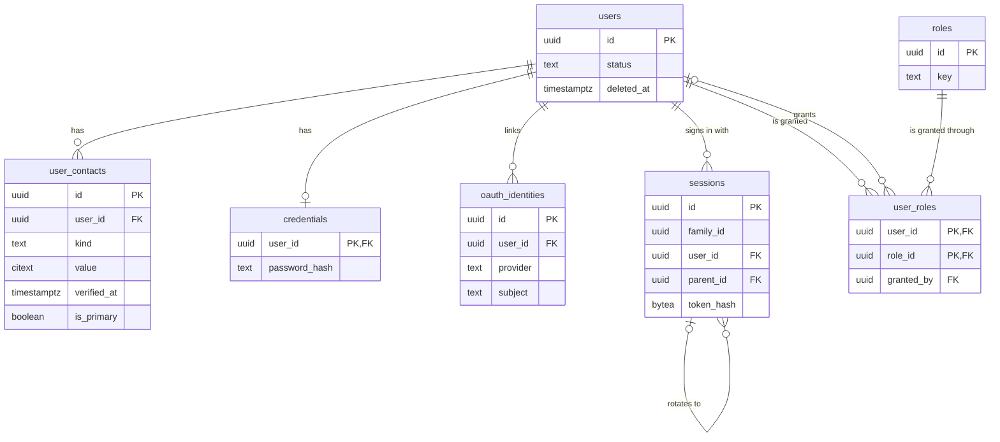
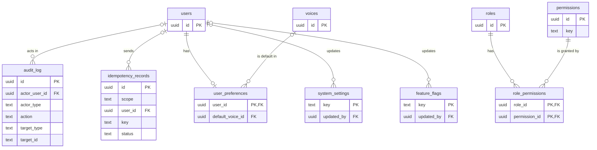
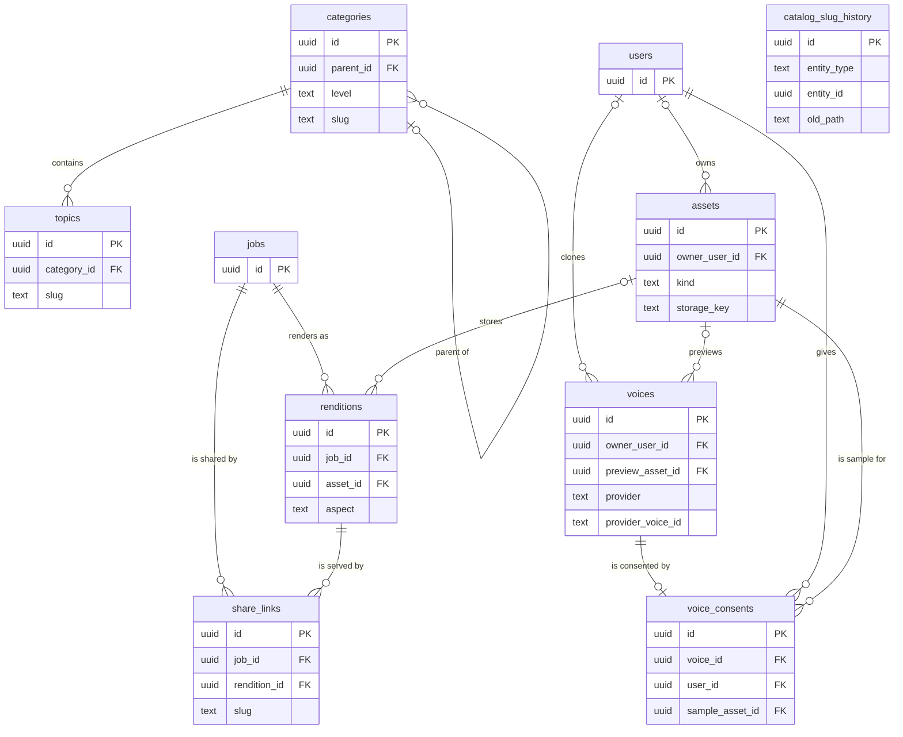
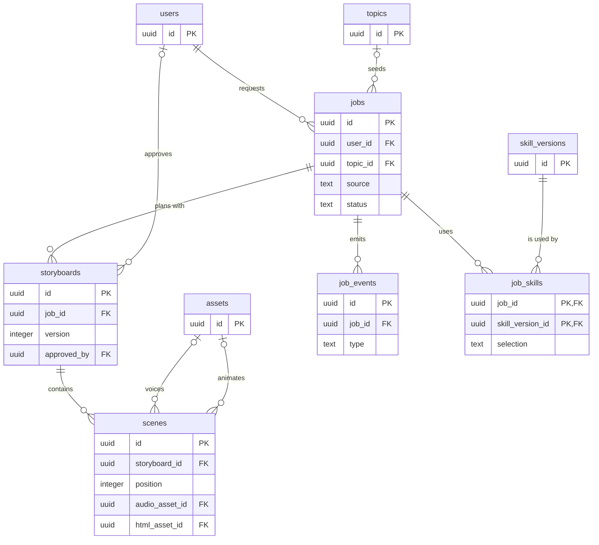
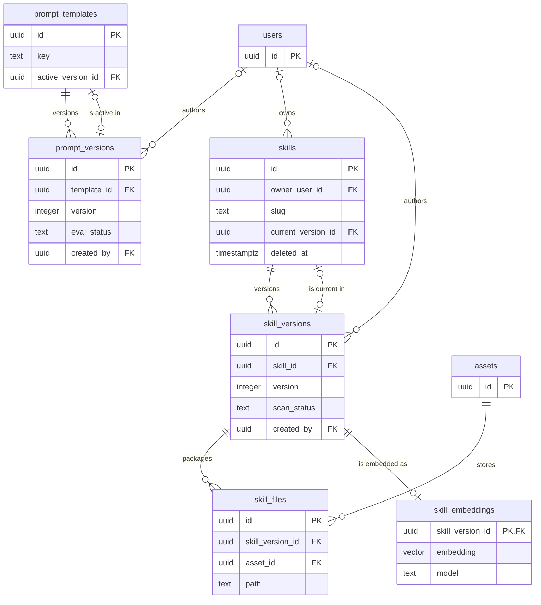
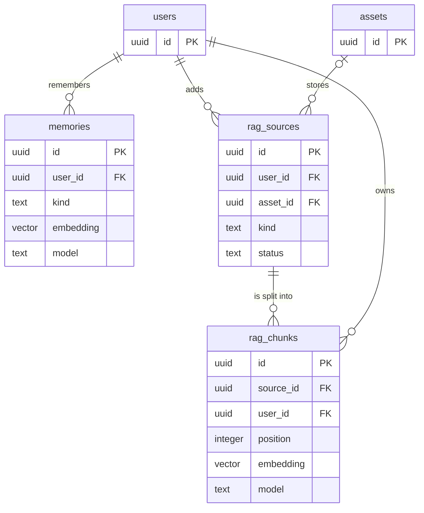
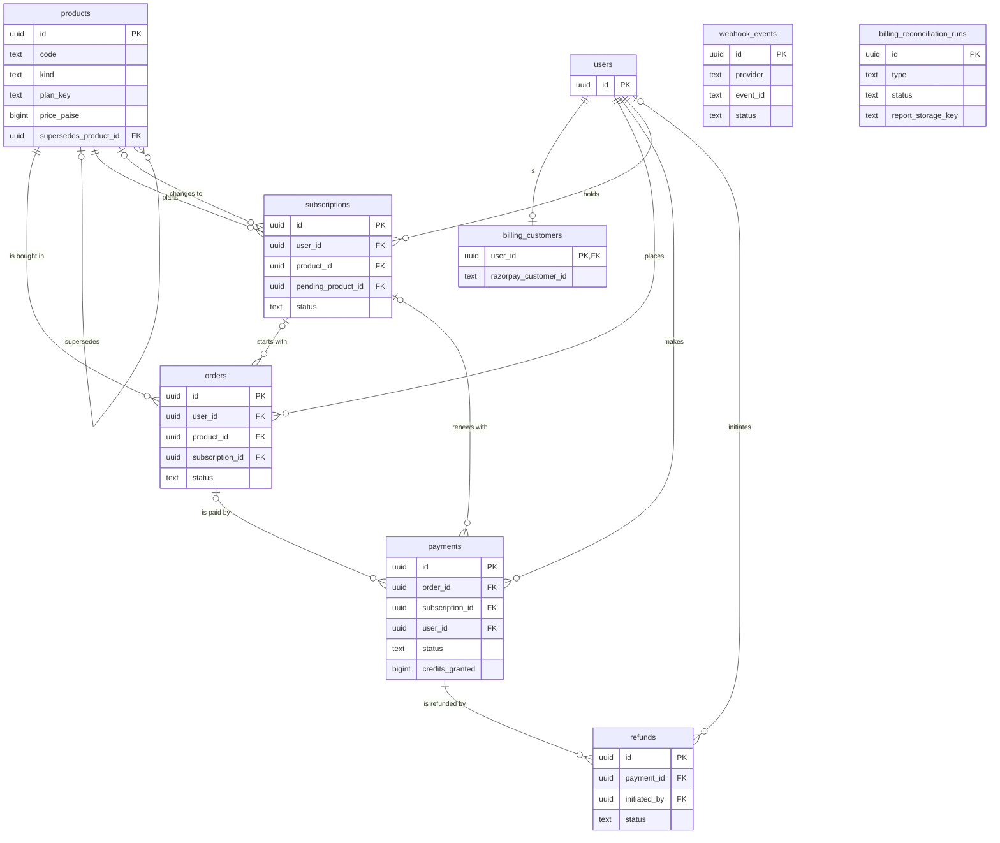
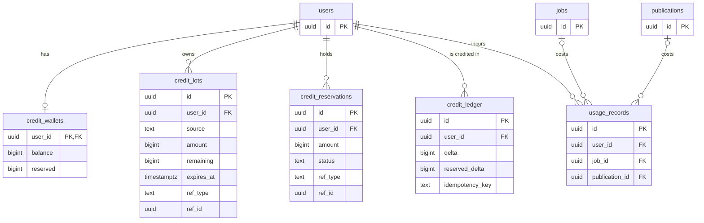
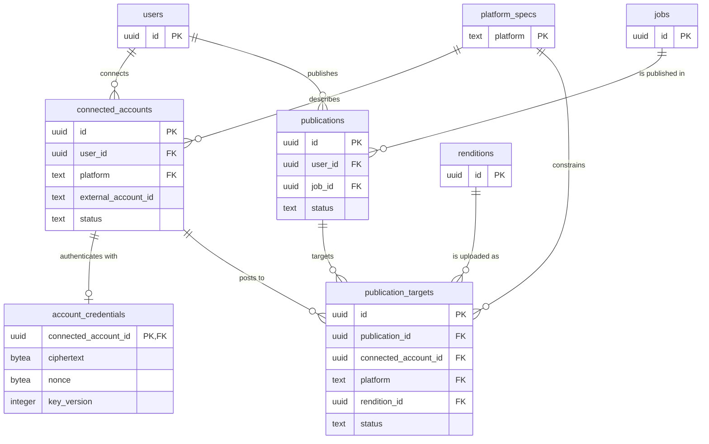
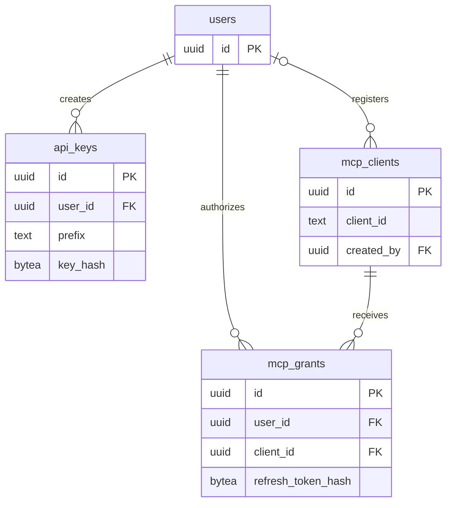

# Entity relationship diagrams

One diagram per domain. Columns shown are keys and the columns that define relationships; [`schema.md`](schema.md) has every column. Tables from another domain appear with only their key so the links are visible.

## Identity

## Platform

## Catalog and media

## Generation

## AI configuration and skills

## Memory and RAG

## Billing

`webhook_events` and `billing_reconciliation_runs` have no foreign keys: events are stored before they are matched to any row, and a run describes a window rather than a row.

## Credits

`credit_lots.ref_id` and `credit_ledger.ref_id` point at a payment, refund, reservation, lot or admin action by type, without a foreign key, so the ledger never blocks a purge of the thing it describes.

## Publishing

## Integrations

