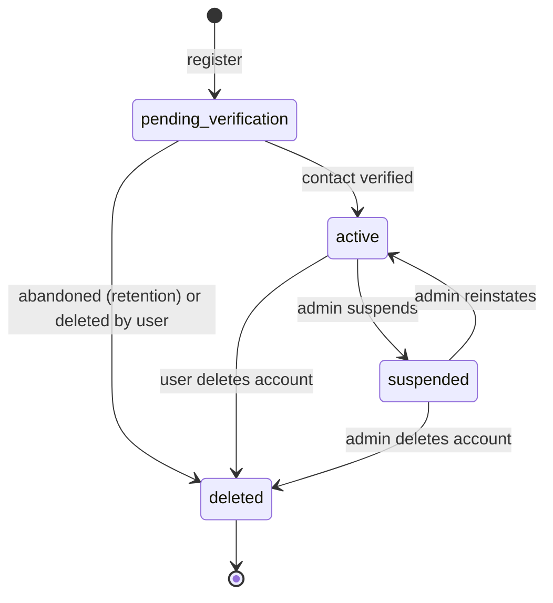
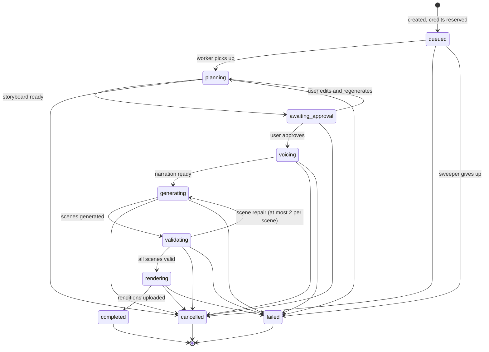
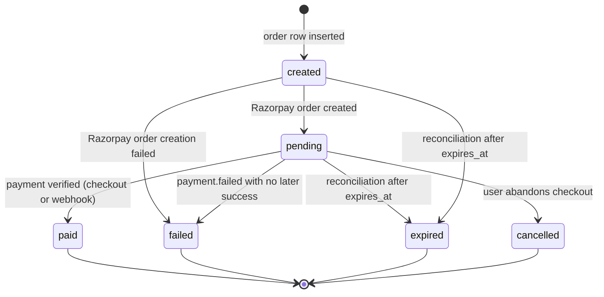
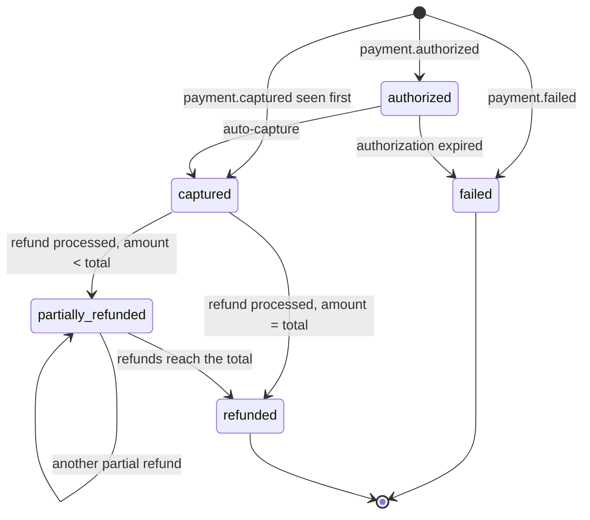
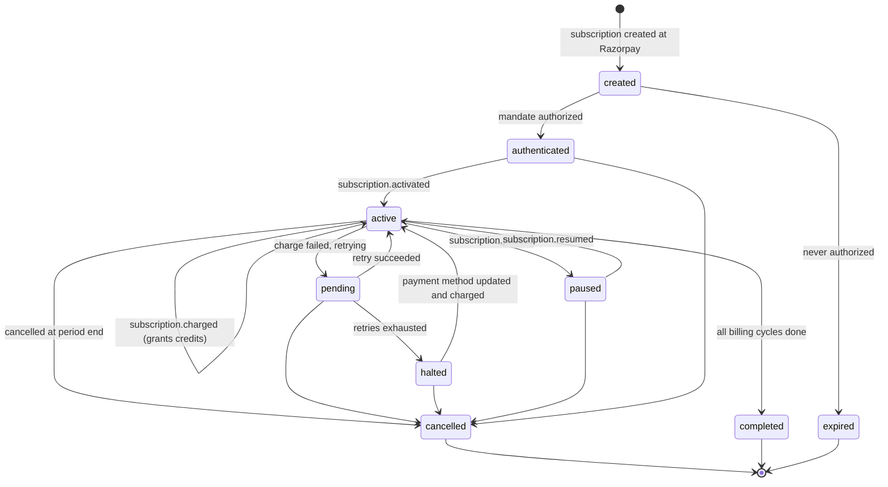
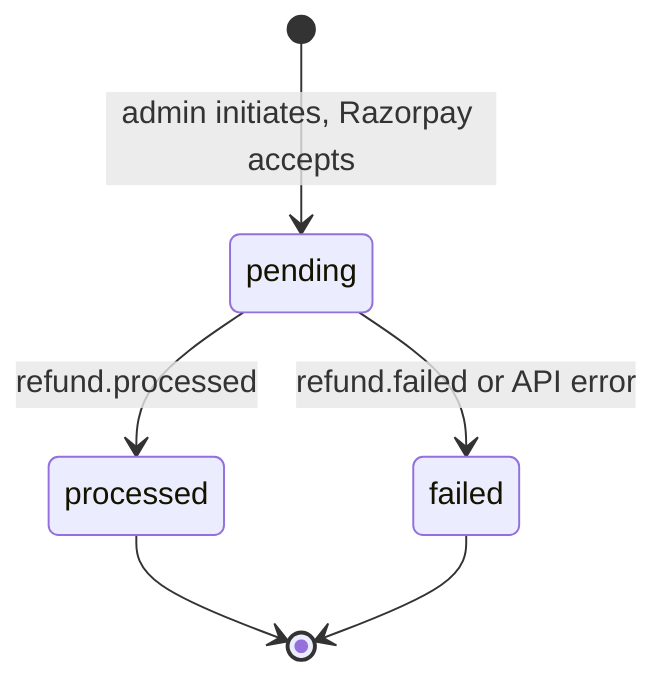
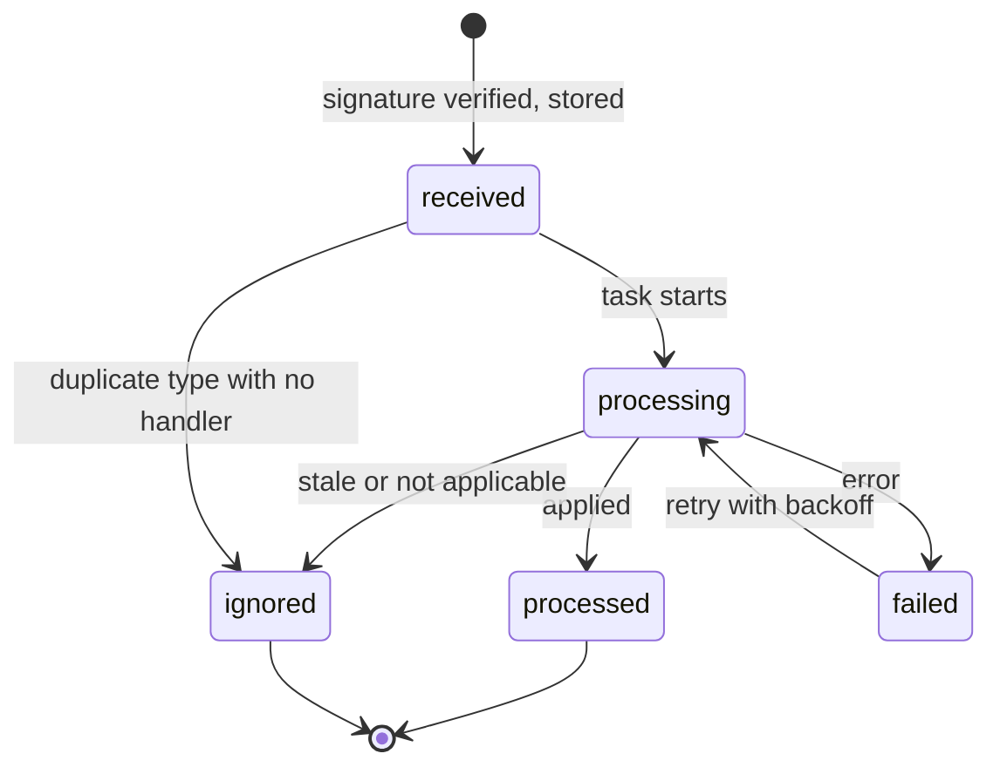
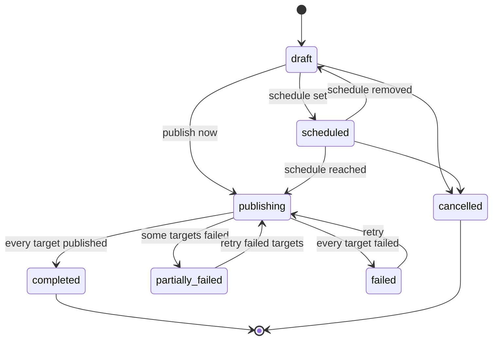
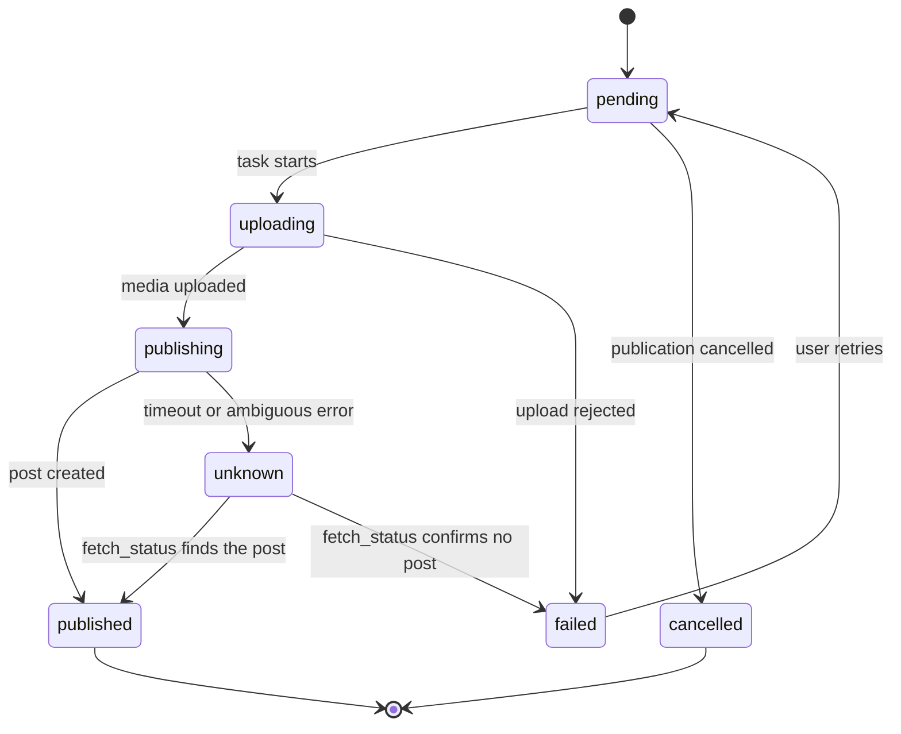
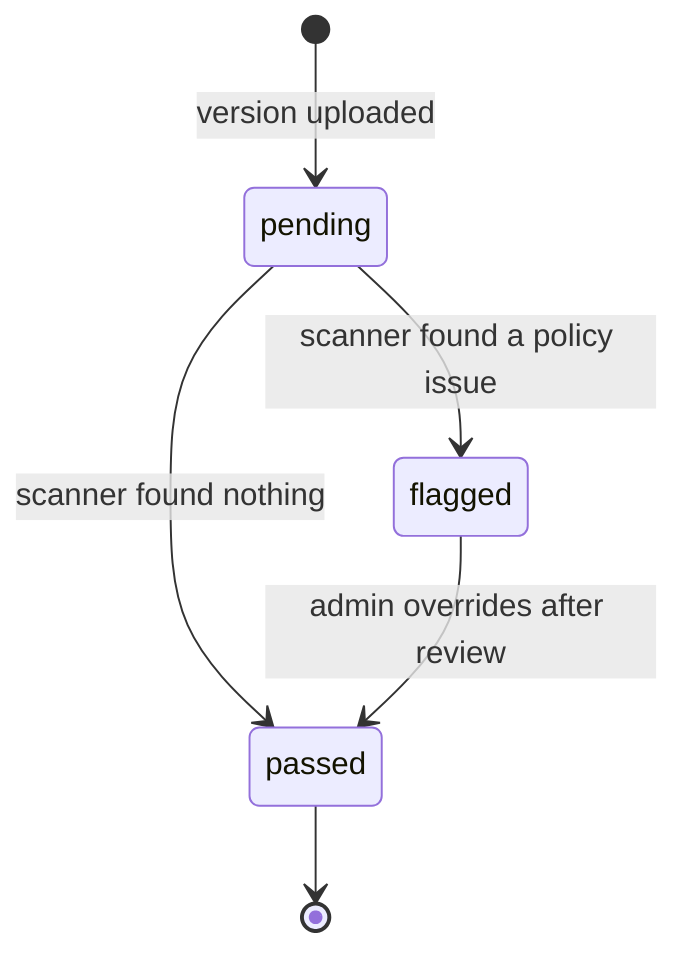

# State machines

Every status column follows an explicit state machine. Services change a status only through a transition function that checks the current state, and every transition is a single `UPDATE ... WHERE id = :id AND status = :expected`, so concurrent writers cannot skip a state. An event that arrives for a transition that is no longer allowed is recorded and ignored, never applied.

Terminal states are marked with `[*]` as an exit.

## `users.status`

- OAuth sign-up with a provider-verified email starts directly in `active`.
- Moving to `suspended` or `deleted` revokes every session with reason `user_suspended` or `logout_all`.
- `deleted` sets `deleted_at`; the row is anonymized or purged by retention.

## `jobs.status`

- MCP jobs (`source = 'mcp'`) skip planning: `queued --> voicing` when only narration is submitted, `queued --> validating` when narration audio already exists.
- `completed` commits the charged credits and releases the rest; `failed` and `cancelled` release the whole reservation.
- `awaiting_approval` jobs expire to `cancelled` after 7 days.

## `orders.status`

- A `payment.captured` webhook for an `expired`, `failed` or `cancelled` order still settles it: the order moves to `paid` through a reconciliation path recorded in the audit log, because the customer was charged. This is the only transition out of those states.

## `payments.status`

## `subscriptions.status`

- `subscription.updated` changes plan or period fields without changing status.
- An event whose `created_at` is older than `subscriptions.last_event_at` is stored with `webhook_events.status = 'ignored'`.

## `refunds.status`

## `webhook_events.status`

- A delivery whose `(provider, event_id)` already exists returns 200 without creating a row; it never reaches this machine again.
- After 10 failed attempts the event stays `failed` and alerts.

## `publications.status`

A publication's status is derived from its targets once publishing starts; it is recomputed whenever a target reaches a final state.

## `publication_targets.status`

- The post-creation call is never retried from `publishing` or `unknown`; only `fetch_status` resolves `unknown`, which prevents duplicate posts.

## `skill_versions.scan_status`

- Only a `passed` version can become a skill's `current_version_id` or be used in a generation.
- `flagged` versions stay unusable until an admin review; the override is audited.
