# State machines

Every status column follows an explicit state machine. Services change a status only through a transition function that checks the current state, and every transition is a single `UPDATE ... WHERE id = :id AND status = :expected`, so concurrent writers cannot skip a state. An event that arrives for a transition that is no longer allowed is recorded and ignored, never applied.

Terminal states are marked with `[*]` as an exit.

## `users.status`

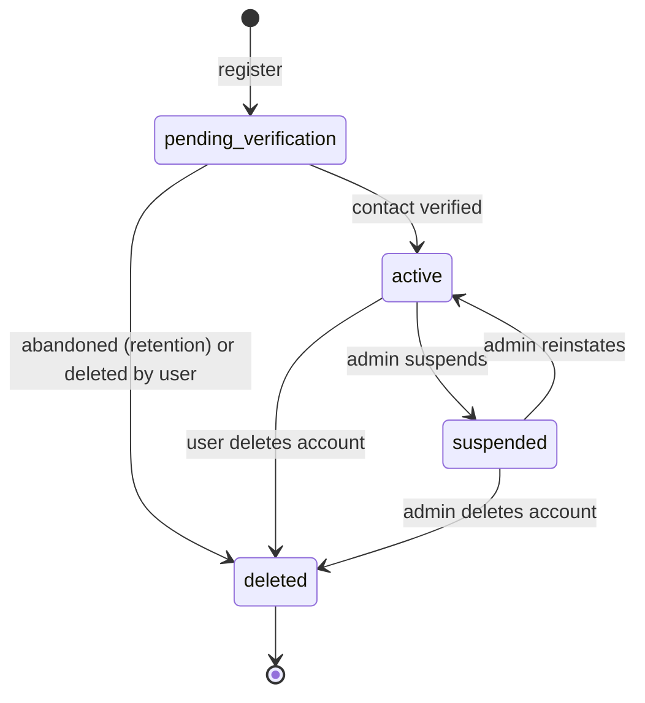

- OAuth sign-up with a provider-verified email starts directly in `active`.
- Moving to `suspended` or `deleted` revokes every session with reason `user_suspended` or `logout_all`.
- `deleted` sets `deleted_at`; the row is anonymized or purged by retention.

## `jobs.status`

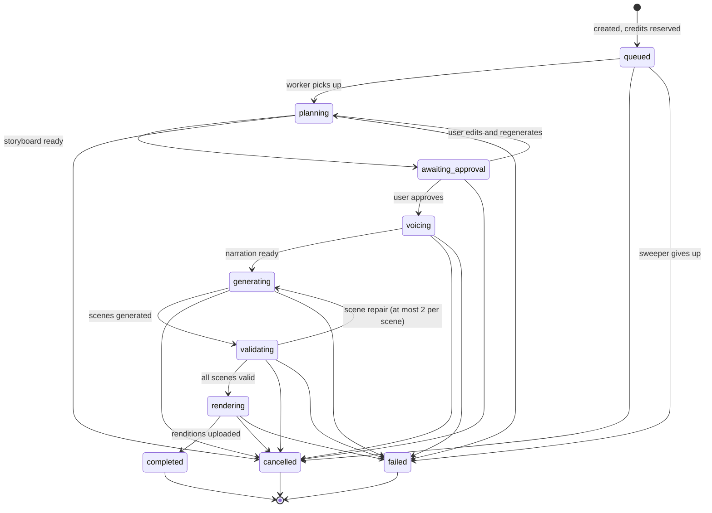

- MCP jobs (`source = 'mcp'`) skip planning: `queued --> voicing` when only narration is submitted, `queued --> validating` when narration audio already exists.
- `completed` commits the charged credits and releases the rest; `failed` and `cancelled` release the whole reservation.
- `awaiting_approval` jobs expire to `cancelled` after 7 days.

## `orders.status`

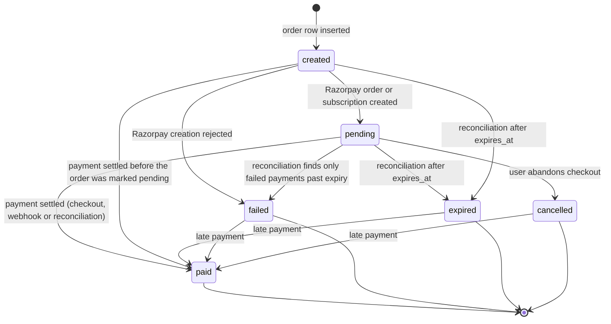

- A captured payment for an `expired`, `failed` or `cancelled` order still settles it: the order moves to `paid` and an audit entry records the late settlement, because the customer was charged. This is the only transition out of those states.
- `payment.failed` never changes the order. Razorpay allows retries on the same order, so the order stays `pending` until it is paid or expires.
- A captured payment whose amount or currency differs from the order is recorded, grants no credits and sets `flagged_at` and `flag_reason`; the order keeps its status, leaves the reconciliation queue and raises an alert. An admin resolves it by refunding the payment.
- A second captured payment for an order that is already `paid` is recorded without credits and flags the order `duplicate_payment`; the order keeps its status and an alert is raised. An admin resolves it by refunding the extra payment.
- A subscription order moves to `paid` when the first `subscription.charged` payment settles.

## `payments.status`

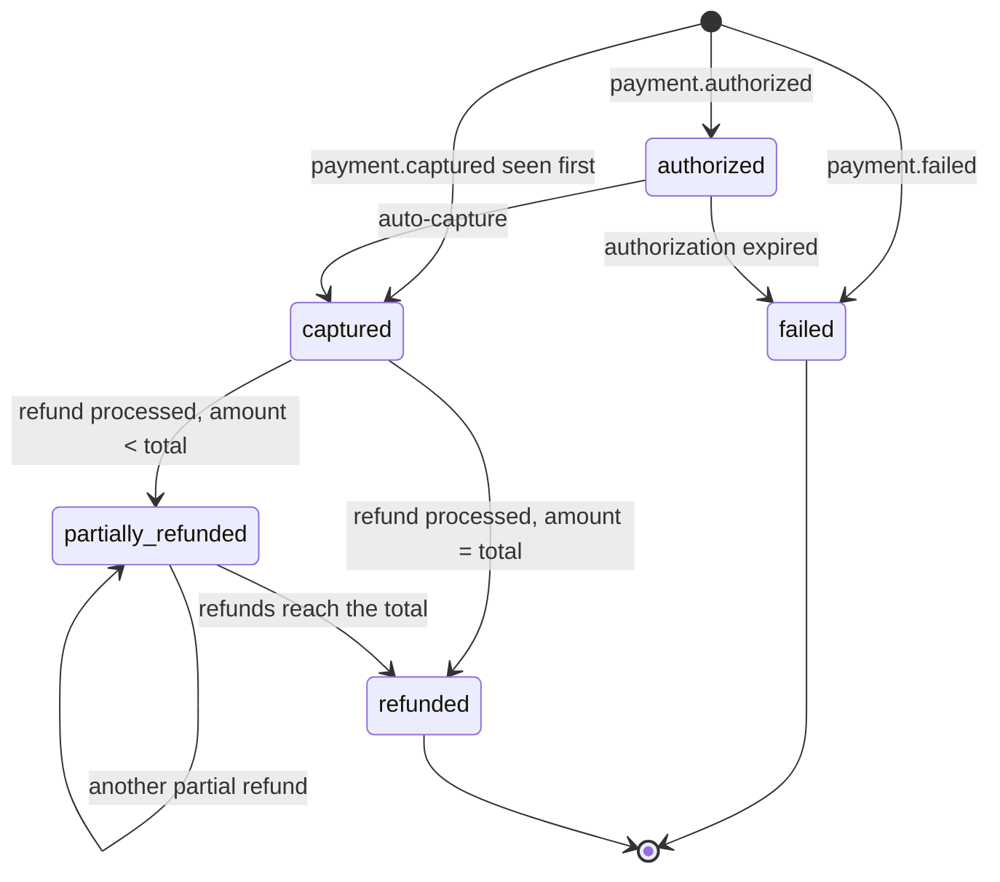

## `subscriptions.status`

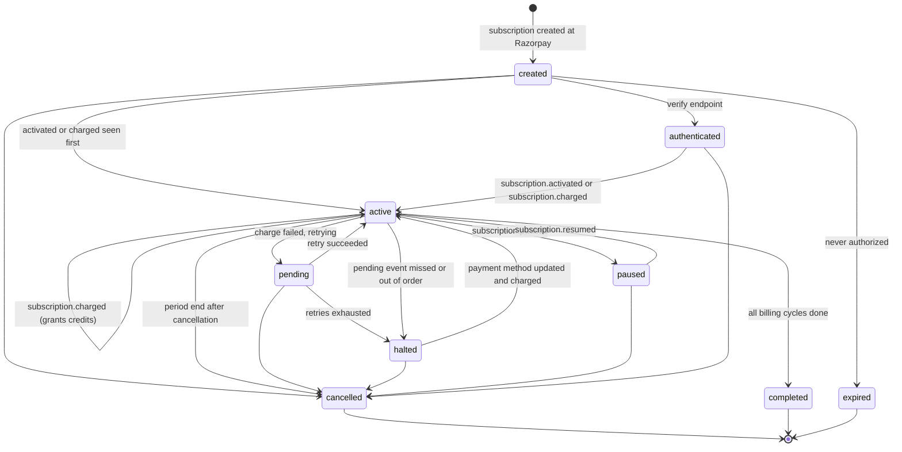

- `subscription.updated` changes plan or period fields without changing status.
- A transition to the state the subscription is already in is a no-op recorded as `processed`; a transition the diagram does not allow is recorded as `ignored` with reason `invalid_transition` and never applied.
- `subscription.activated` after the subscription already left `created` and `authenticated` is a no-op recorded as `processed`: a `charged` event that arrived first has already activated it.
- Period fields only move forward: an event or sync whose `current_end` is older than the stored one leaves them alone.
- A subscription that leaves a live status needs no further events: `cancelled`, `completed` and `expired` rows no longer count toward the one-live-subscription-per-user index, so a new subscription can be started.
- A `charged` event for a subscription that already ended (`cancelled`, `completed`, `expired`) still records the payment and grants the credits, leaves the status alone and raises an alert.
- A subscription left in `created` by reordered events (for example an activation older than an already applied update) is repaired by the daily sync, which also covers `created` subscriptions that already have a Razorpay ID.
- The daily subscription sync and the finalization task use the same machine; when Razorpay is further along than a webhook told us, the sync walks the shortest path of allowed transitions to the Razorpay state and never moves a subscription backwards.
- A subscription event whose `created_at` is older than `subscriptions.last_event_at` never changes status, period or plan; it is stored with `webhook_events.status = 'ignored'` and `ignored_reason = 'stale'`.
- A `subscription.charged` event is applied in full even when stale: recording the payment and granting credits is idempotent per payment ID, and money received is never ignored. Only its status and period effects are skipped when stale.
- `subscription.cancelled` records `cancelled_at` and `cancel_at_period_end`. The status becomes `cancelled` immediately when there is no paid period left; otherwise it changes when the period ends, through the periodic finalization task, so access lasts to the end of the paid period.
- Every transition is a single `UPDATE ... WHERE status = :expected` checked against this diagram; a transition the diagram does not allow is ignored.

## `refunds.status`

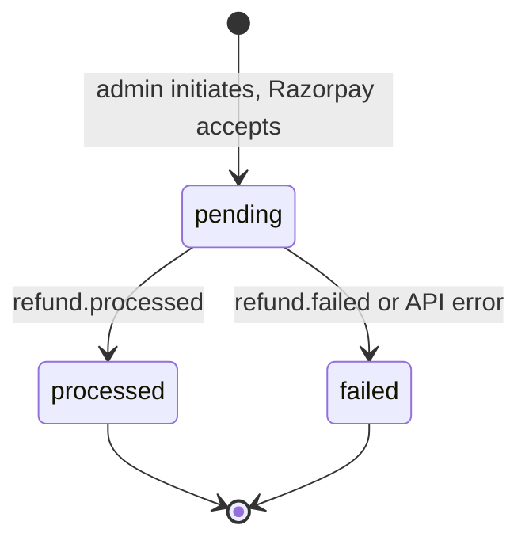

## `webhook_events.status`

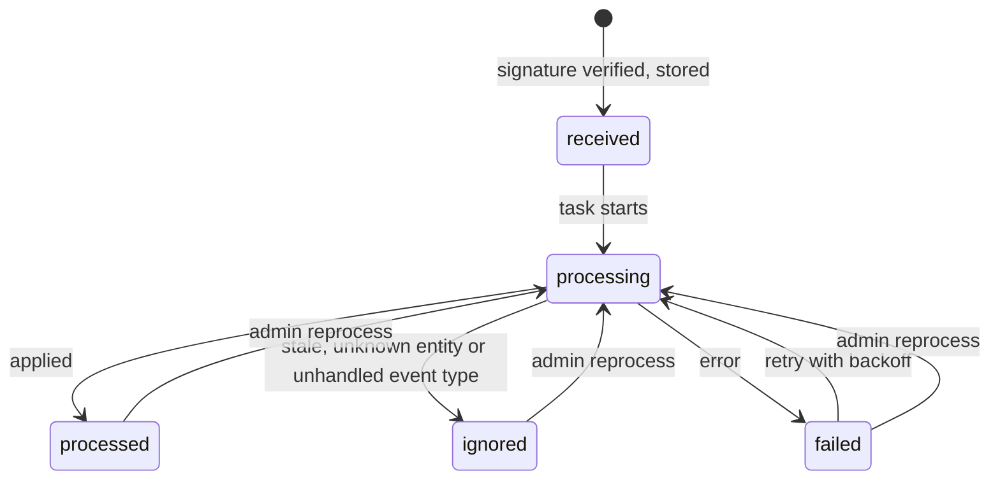

- A delivery whose `(provider, event_id)` already exists returns 200 without creating a row; it never reaches this machine again. A duplicate whose stored row is still `received` after 60 seconds is queued again.
- After 10 failed attempts the event stays `failed` and raises an alert.
- Reprocessing is safe because every handler is idempotent.

## `credit_reservations.status`

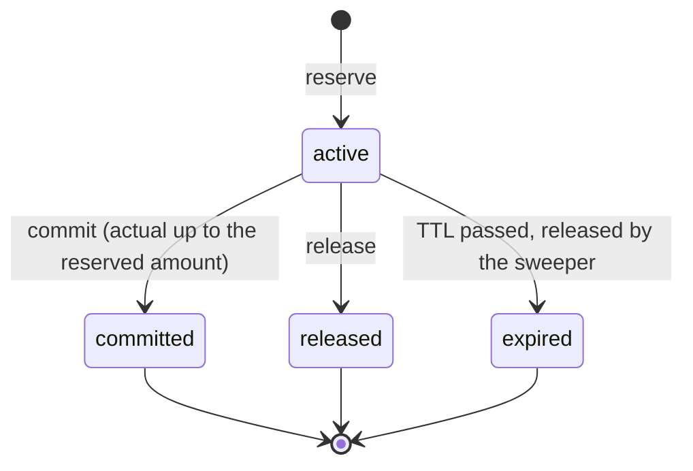

- `commit` consumes the actual amount from lots in expiry order and releases the rest in the same ledger row.
- A repeated call with the same idempotency key returns the original result; any other call on a settled reservation fails with `reservation_not_active`.

## `billing_reconciliation_runs.status`

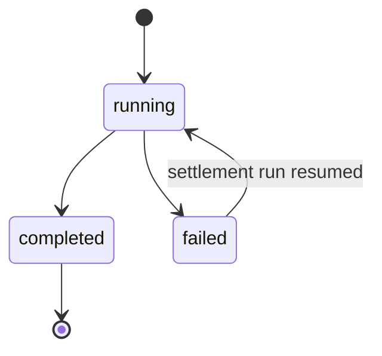

- A `settlement` run is unique per UTC day. A `failed` run, or a `running` run older than one hour, is resumed by the next attempt; a `completed` run is never repeated.

## `publications.status`

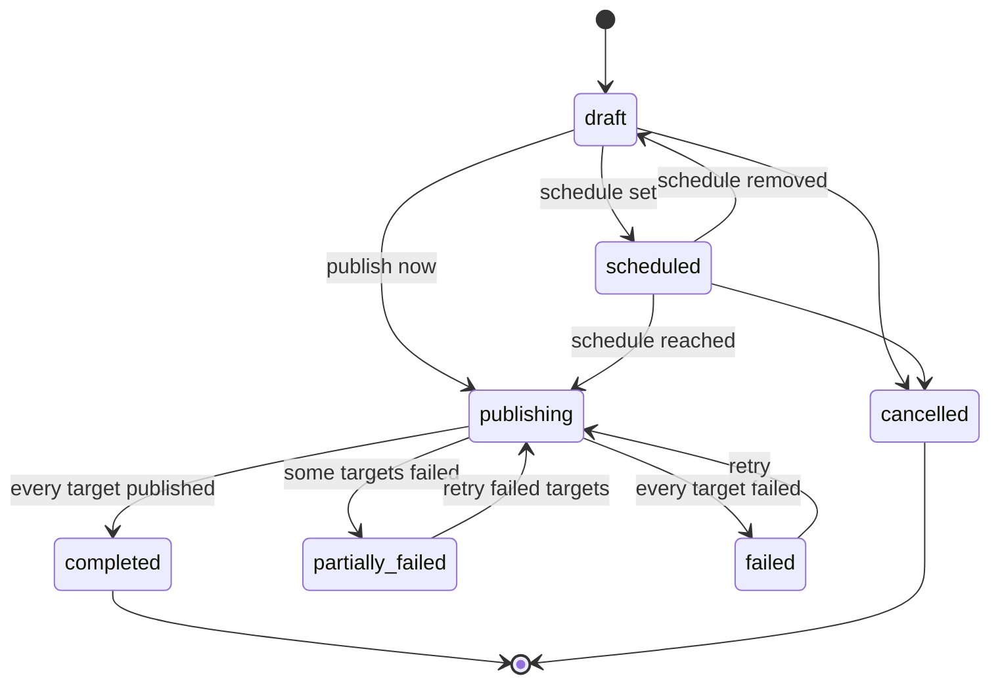

A publication's status is derived from its targets once publishing starts; it is recomputed whenever a target reaches a final state.

## `publication_targets.status`

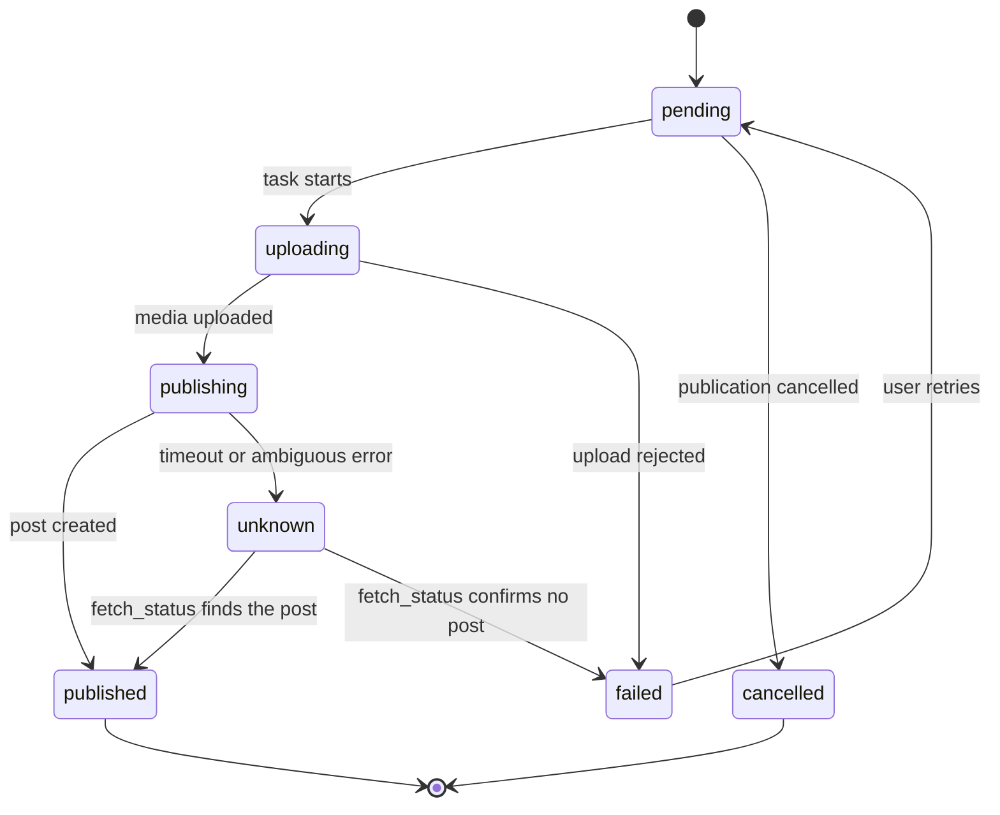

- The post-creation call is never retried from `publishing` or `unknown`; only `fetch_status` resolves `unknown`, which prevents duplicate posts.

## `skill_versions.scan_status`

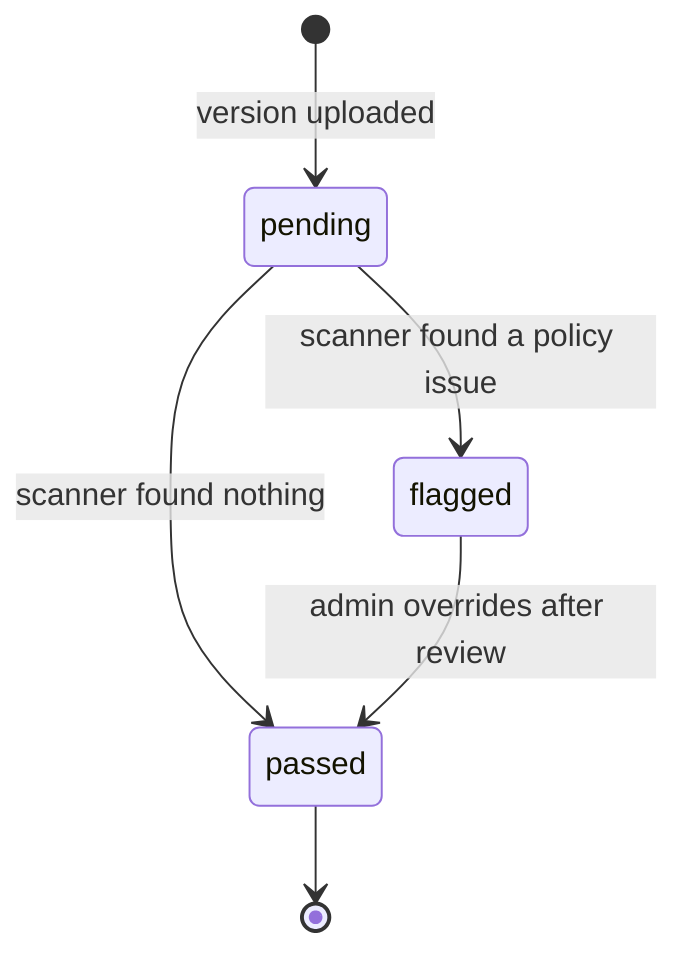

- Only a `passed` version can become a skill's `current_version_id` or be used in a generation.
- `flagged` versions stay unusable until an admin review; the override is audited.
