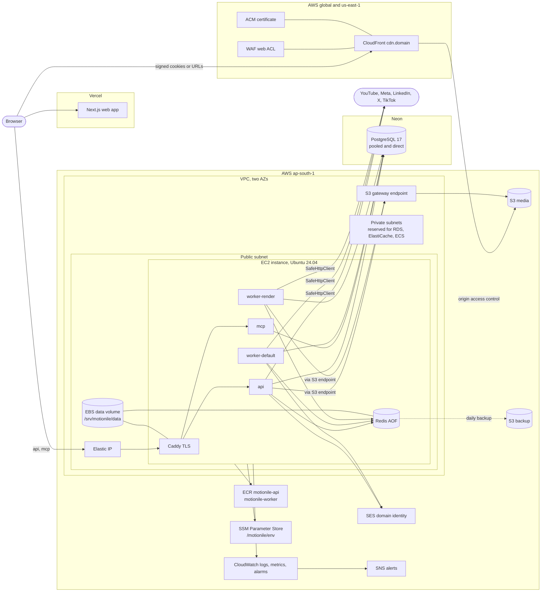
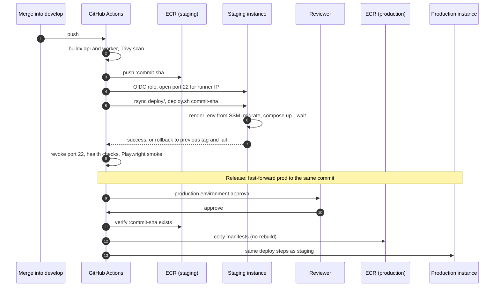

# Infrastructure

Motionile runs one AWS environment per stage in `ap-south-1`, built from the same OpenTofu module. The web app runs on Vercel; Postgres runs on Neon (or RDS when `enable_rds` is set). This page describes the topology; the [runbooks](runbooks/) say how to build and operate it.

| Branch    | Environment  | Web                       | API and MCP                               |
| --------- | ------------ | ------------------------- | ----------------------------------------- |
| `develop` | `staging`    | Vercel, staging domain    | EC2 `motionile-staging`, `c7i.xlarge`     |
| `prod`    | `production` | Vercel, production domain | EC2 `motionile-production`, `c7i.2xlarge` |

The phase brief calls these branches `staging` and `main`; this repository names them `develop` and `prod`.

## Topology

## Deployment flow

## Components

| Concern           | Implementation                                                                                                                                       | Code                                       |
| ----------------- | ---------------------------------------------------------------------------------------------------------------------------------------------------- | ------------------------------------------ |
| State             | S3 bucket with versioning, encryption, TLS-only policy; native S3 lockfile locking; one key per environment                                          | `infra/aws/bootstrap`, `envs/*/backend.tf` |
| Network           | VPC, two public and two private subnets, internet gateway, S3 gateway endpoint, no NAT, rejected-traffic flow logs                                   | `modules/network`                          |
| Compute           | One EC2 instance, IMDSv2 hop limit 2 ([ADR 0011](adr/0011-imdsv2-hop-limit-two.md)), encrypted root and data volumes, daily snapshots, auto-recovery | `modules/compute`                          |
| Bootstrap         | cloud-init installs Docker, the Compose plugin, AWS CLI, CloudWatch agent, fail2ban, unattended upgrades, the `deploy` user and systemd timers       | `modules/compute/templates`                |
| Images            | ECR `<env>/motionile-api` and `<env>/motionile-worker`, immutable tags, scan on push, keep 30 tagged, expire untagged after 7 days                   | `modules/registry`                         |
| Media and backups | Private buckets, ownership enforced, TLS only, SSE-S3, versioning, lifecycle rules, CORS for the web origin                                          | `modules/storage`                          |
| CDN               | CloudFront with OAC; `/media/*` signed cookies, `/share/*` signed URLs, everything else 403; HTTP/2 and HTTP/3; logs to the backup bucket            | `modules/cdn`                              |
| Edge protection   | WAF: IP reputation list, per-IP rate limit, `/media/*` referer rule, logs with cookies and query strings redacted                                    | `modules/waf`                              |
| Email             | SES identity with Easy DKIM, MAIL FROM, configuration set, bounces and complaints to SNS                                                             | `modules/email`                            |
| Observability     | Log group, awslogs driver ([ADR 0012](adr/0012-container-logs-through-awslogs.md)), agent metrics, log metric filters, alarms, encrypted alert topic | `modules/observability`                    |
| CI access         | GitHub OIDC provider, one deploy role per environment trusting only that GitHub environment                                                          | `modules/iam-github`                       |
| Configuration     | `/motionile/<env>/*` from the catalog `deploy/parameters.csv` ([ADR 0013](adr/0013-one-environment-module-and-parameter-catalog.md))                 | `modules/secrets`, `deploy/scripts`        |
| DNS               | Route 53 records when `manage_dns` is true, otherwise every record as an output                                                                      | `modules/dns`                              |
| Database          | Neon by default; optional RDS PostgreSQL 17 in the private subnets                                                                                   | `modules/database`                         |

## Server layout

| Path                         | Contents                                                        |
| ---------------------------- | --------------------------------------------------------------- |
| `/srv/motionile/bundle`      | The `deploy/` directory, synced on every deployment             |
| `/srv/motionile/.env`        | Rendered from SSM by `render-env.sh`, mode 600                  |
| `/srv/motionile/state`       | `current-tag`, `previous-tag`, `images.env`, `deploy.lock`      |
| `/srv/motionile/logs`        | `deploy.log`, shipped to CloudWatch                             |
| `/srv/motionile/data`        | EBS data volume: `redis/`, `caddy/data`, `caddy/config`         |
| `/etc/motionile/environment` | `MOTIONILE_ENVIRONMENT` and `AWS_REGION`, written by cloud-init |

## Security boundaries

- No secret is stored in code, OpenTofu state, logs or workflow output. Secrets are SecureString parameters uploaded by the owner, and GitHub holds only the SSH deploy key.
- Port 22 is closed. Deployments open it for the runner's IP and always revoke it; humans use Session Manager.
- The GitHub deploy role can push to its environment's repositories and change only port 22 on its environment's security group. Production's role can also read staging's repositories to promote images.
- The instance role can only pull its images, read its parameters, use its two buckets, send from its SES identity and write its logs.
- Media is reachable only through CloudFront with a valid signature; the bucket policy trusts only that distribution.

## Later

Per `docs/context.md`, `worker-render` moves to ECS with queue-depth autoscaling, the API moves behind an ALB and Redis moves to ElastiCache. The private subnets already exist for that move.
